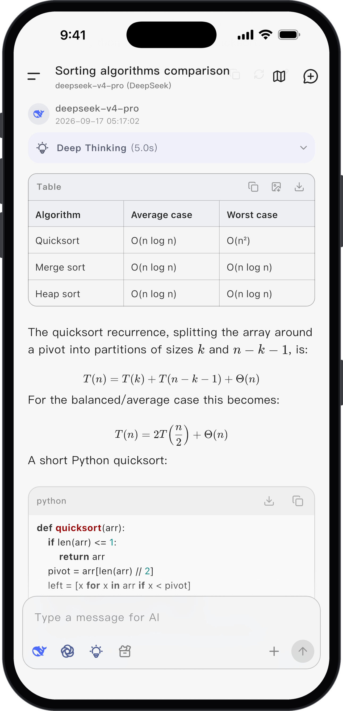
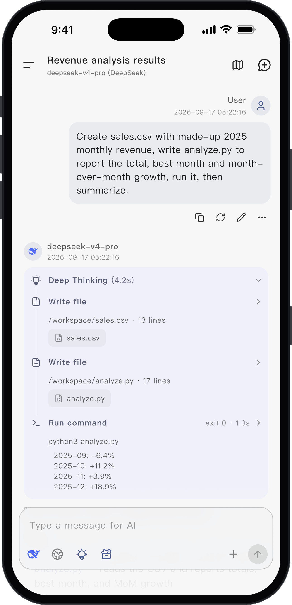
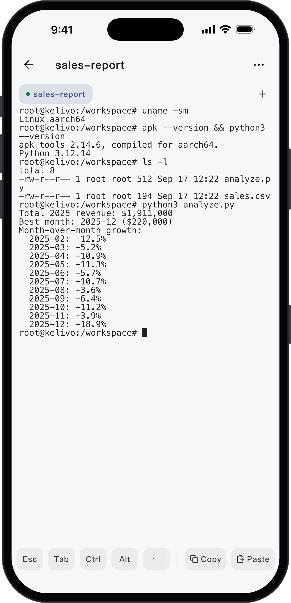
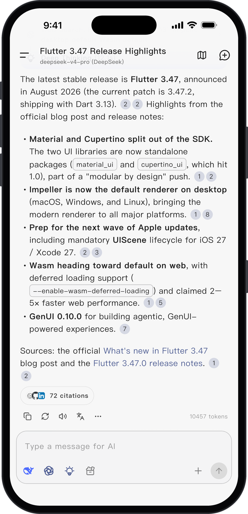

<div align="center">


# Kelivo

**Mobil ve masaüstü için açık kaynaklı bir LLM istemcisi.**

Tüm büyük modelleri tek bir uygulamada kullanın, gerçek işler yapması için bir çalışma alanı verin ve verilerinizi kendi cihazınızda tutun.

<p>
  <a href="https://github.com/Chevey339/kelivo/releases/latest"></a>
  <a href="https://github.com/Chevey339/kelivo/releases"></a>
  <a href="https://github.com/Chevey339/kelivo/stargazers"></a>
  <a href="LICENSE"></a>
  <a href="https://flutter.dev"></a>
</p>

<p>
  <a href="https://discord.gg/Tb8DyvvV5T"></a>
  <a href="https://qm.qq.com/q/OQaXetKssC"></a>
</p>

<a href="https://trendshift.io/repositories/15452?utm_source=repository-badge&amp;utm_medium=badge&amp;utm_campaign=badge-repository-15452" target="_blank" rel="noopener noreferrer"></a>

[Web Sitesi](https://kelivo.psycheas.top) · [Kullanım Kılavuzu](https://kelivo.psycheas.top/guide) · [İndir](#-indirme) · [Sorun Bildir](https://github.com/Chevey339/kelivo/issues)

[English](README.md) · [简体中文](README_ZH_CN.md) · **Türkçe**

</div>

## 💡 Genel Bakış

Kelivo; Android, iOS, macOS, Windows ve Linux için Flutter ile geliştirilmiş çapraz platformlu bir LLM istemcisidir. Kendi API anahtarlarınızı bağlayın veya desteklenen bir abonelikle oturum açın; OpenAI, Gemini, Claude, DeepSeek, OpenRouter ve OpenAI uyumlu herhangi bir servis arasında uygulama değiştirmeden geçiş yapın.

Kelivo sohbetin ötesine geçer. Modeller web'de arama yapabilir, MCP sunucularını çağırabilir, becerileri (skills) takip edebilir ve sizin için önemli olanları hatırlayabilir. Bir sohbeti bir **çalışma alanına (workspace)** bağladığınızda model dosyaları okuyup düzenleyebilir ve komutlar çalıştırabilir: telefonunuzda bir Linux sanal alanı (sandbox) içinde veya bilgisayarınızda yerel bir kabukta.

Sohbetler, ayarlar ve dosyalar yerel olarak saklanır. Kelivo'nun kendi hesap sistemi yoktur; istediğiniz zaman WebDAV veya S3 uyumlu depolamaya yedekleme yapabilirsiniz.

## 💖 Sponsorlar

<table>
<tr>
<td width="180" align="center" valign="middle">
  <a href="https://sta1n.ai/"></a><br />
  <b><a href="https://sta1n.ai/">STA1N API🍪</a></b>
</td>
<td valign="middle">Kelivo'ya sponsor olduğu için <a href="https://sta1n.ai/">STA1N API🍪</a>'ye teşekkürler! Rol yapma (RP) ve karakter sohbetine odaklanan bir API servisi.</td>
</tr>
<tr>
<td width="180" align="center" valign="middle">
  <a href="https://api.10dianai.com"></a><br />
  <b><a href="https://api.10dianai.com">10dian-API</a></b>
</td>
<td valign="middle">Kelivo'ya sponsor olduğu için <a href="https://api.10dianai.com">10dian-API</a>'ye teşekkürler! 10dian-API, geliştiriciler ve yapay zeka meraklıları için şeffaf, uygun fiyatlı ve kullanıcı deneyimine odaklanan güvenli, hızlı ve kararlı API hizmetleri sunar. %100 gerçek modeller ve model ikamesi yapmama sözü verir. Yapay zeka dünyasının kilidini açmak için tek anahtar!</td>
</tr>
<tr>
<td width="180" align="center" valign="middle">
  <a href="https://sui-xiang.com"></a><br />
  <b><a href="https://sui-xiang.com">随想AI中转</a></b>
</td>
<td valign="middle">Bu projeye sponsor olduğu için <a href="https://sui-xiang.com">随想AI中转</a>'a teşekkürler! 随想AI中转; Claude, Codex, Gemini ve diğer modeller için aktarım hizmeti sunan güvenilir ve verimli bir API aktarım sağlayıcısıdır. Gizlilik odaklı, veri satışı ve model karıştırma olmayan, şeffaf ve hızlı satış sonrası destek sunan bir platformdur. Yeni kayıtlarda günlük girişle 0,5 yuan test kredisi, 1:1 yükleme oranı, aboneliksiz kullandıkça öde modeli sunar. Çoklu hat yedekliliği, bölgeler arası felaket kurtarma, otomatik hata devri ve kesintisiz uzun SSE bağlantılarıyla %99,9 erişilebilirlik sağlar.</td>
</tr>
<tr>
<td width="180" align="center" valign="middle">
  <a href="https://api.muteki.site/register?aff=kelivo&promo=kelivo"></a>
</td>
<td valign="middle"><b><a href="https://api.muteki.site/register?aff=kelivo&promo=kelivo">MaruCode</a></b>, yarım yılı aşkın süredir kendi hesap havuzuyla hizmet veren bir API sağlayıcısıdır. Bakiye yükleme tuzakları olmadan başta Codex (GPT 6.2 Astra Sol vb.), Claude Code (Claude Fable 5.2, Opus 5.5 vb.) ve GPT Image 2.6 olmak üzere başlıca modelleri sunar; özel WebSocket protokolü desteği, %90+ önbellek isabet oranı ve şeffaf fiyatlandırma (Codex 0.3x, CC 1.7x) sağlar. Okullar, şirketler, stüdyolar ve bireysel geliştiriciler için uygundur. <a href="https://images-2.muteki.site">Görsel Üretim Stüdyosu🖼️</a></td>
</tr>
<tr>
<td width="180" align="center" valign="middle">
  <b><a href="https://ai.ota1245.top/">砂糖酒馆</a></b>
</td>
<td valign="middle">Kelivo'ya sponsor olduğu için <a href="https://ai.ota1245.top/">砂糖酒馆</a>'a teşekkürler! İstek başına şeffaf fiyatlandırmayla karakter sohbetine odaklanır. Gemini, Claude, DeepSeek ve GLM dahil başlıca metin modellerinin yanı sıra NAI görsel üretimi, TTS ve video modelleri sunar. Veri satışı veya model ikamesi olmadan gizliliğe öncelik verir ve 1:1 bakiye yükleme oranı sunar. <a href="https://www.16688.com.cn/shop/S929990">Kredi satın al</a>.</td>
</tr>
</table>

Kelivo işinize yarıyorsa, [projeyi WeChat üzerinden de destekleyebilirsiniz](docx/sponsor.jpg).

## 📸 Ekran Görüntüleri

<p align="center">
  
  
  
  
</p>

## 🚀 İndirme

| Platform | Kelivo'yu Edinin | Paket | Gereksinimler |
| --- | --- | --- | --- |
| iOS / iPadOS | [App Store](https://apps.apple.com/us/app/kelivo/id6752122930) · [TestFlight](https://testflight.apple.com/join/erbGGykR) (beta) | App Store veya [Releases](https://github.com/Chevey339/kelivo/releases/latest) sayfasında imzasız IPA | iOS 15.0 veya üzeri |
| Android | [GitHub Releases](https://github.com/Chevey339/kelivo/releases/latest) | APK (`arm64-v8a`, `armeabi-v7a`, `x86_64`) | Android 7.0 veya üzeri |
| macOS | [GitHub Releases](https://github.com/Chevey339/kelivo/releases/latest) | DMG | macOS 12.0 veya üzeri, Apple Silicon veya Intel |
| Windows | [GitHub Releases](https://github.com/Chevey339/kelivo/releases/latest) | Kurulum (`setup.exe`) veya taşınabilir ZIP | Windows 10 veya 11 |
| Linux | [GitHub Releases](https://github.com/Chevey339/kelivo/releases/latest) | AppImage, DEB, RPM, tar.gz | x86_64 |
| HarmonyOS | [kelivo-ohos](https://github.com/Chevey339/kelivo-ohos) | Ayrı bir depoda sürdürülmektedir | — |

Linux, video oynatma için sistem oynatıcısını kullanır. AppImage veya tar.gz derlemelerinde video kapakları için `ffmpeg` kurun.

Web sitesindeki [indirme sayfası](https://kelivo.psycheas.top/downloads) da aynı derlemeleri listeler.

## 🧭 Başlangıç

1. **Bir model sağlayıcısı ekleyin.** **Settings → Providers** bölümünü açın, hazır bir sağlayıcı için API anahtarı girin veya kendi uç noktanızı ekleyin, ardından model listesini çekin. Bunun yerine bir ChatGPT, Grok veya Kimi Code hesabı kullanmak için **Add Provider** altındaki **Accounts** sekmesinden oturum açın.
2. **Bir sohbet başlatın.** Giriş çubuğundan bir model seçin. Aynı çubuktan mevcut sohbet için web aramasını, MCP sunucularını, araçları veya akıl yürütmeyi (reasoning) açın.
3. **Modelin dosyalarla çalışmasına izin verin (isteğe bağlı).** **Settings → Workspace & environment** bölümünü açıp bir çalışma alanı oluşturun, ardından bunu sohbet içinden bir konuşmaya bağlayın. Android ve iOS'ta önce aynı sayfadan Linux ortamını kurun; iOS ortamı uygulamayla birlikte paketlenmiştir, bu nedenle ek indirme gerekmez.

[Kullanım Kılavuzu](https://kelivo.psycheas.top/guide) (Çince) sağlayıcıları, belleği, dünya kitaplarını (world books) ve daha fazlasını kapsar.

## ✨ Özellikler

### 🧠 Modeller ve Sağlayıcılar

- **Yerel protokoller**: OpenAI Chat Completions ve Responses API, Google Gemini ve Vertex AI ve Anthropic Claude; ayrıca kendi barındırdığınız modeller dahil OpenAI uyumlu herhangi bir uç nokta.
- **Yerleşik hazır ayarlar**: OpenAI, Gemini, Claude, DeepSeek, OpenRouter, SiliconFlow, Alibaba Cloud, Zhipu AI, xAI, ByteDance ve daha fazlası için.
- **Hesapla oturum açma**: Doğrudan bir ChatGPT (Codex), Grok veya Kimi Code hesabı kullanın. Kelivo kullanılabilir modelleri senkronize eder ve kullanım limitlerinizi gösterir.
- **Model yetenekleri**: Her model için giriş ve çıkış kiplerini, araç kullanımını ve akıl yürütmeyi ayarlayın. Kapalıdan maksimuma kadar bir akıl yürütme düzeyi seçin veya özel bir token bütçesi belirleyin.
- **Sağlayıcı tarafı araçlar** (desteklenen yerlerde): yerel web araması, URL bağlamı, kod yürütme, kod yorumlayıcı ve görsel üretimi.
- **Sağlayıcı başına birden fazla API anahtarı**: sırayla (round-robin), öncelikli, en az kullanılan veya rastgele yük dengeleme ve otomatik hata takibi ile.
- **İstek kontrolü**: sağlayıcı, model veya asistan düzeyinde özel üstbilgiler ve istek gövdesi; sağlayıcı başına HTTP, HTTPS veya SOCKS5 vekil sunucusu; Claude istem önbellekleme; bakiye sorgulama; üstel geri çekilme (exponential backoff) ile otomatik yeniden deneme.
- **Düzenleme ve paylaşım**: sağlayıcıları gruplandırın ve sağlayıcı yapılandırmalarını QR kodu veya metin olarak paylaşın ya da içe aktarın.

### 🤖 Ajan ve Çalışma Alanları

- **Çalışma alanları (Workspaces)**: modele şu sekiz aracı vermek için bir sohbeti çalışma alanına bağlayın: `shell`, `read_file`, `view_image`, `write_file`, `edit_file`, `list_dir`, `glob` ve `grep`. Komut çıktıları canlı akar, dosya düzenlemeleri fark (diff) olarak görünür ve yetkili klasörler dışındaki dosya erişimleri ile masaüstü komutları onay ister. Bir sohbet, MCP ve desteklenen yerel eylemler dahil sıradan araç onaylarını atlamak için Tam Erişim'i (Full access) açıkça etkinleştirebilir.
- **Telefonunuzda bir Linux sanal alanı**: Android, PRoot aracılığıyla Ubuntu, Debian veya Alpine Linux ya da içe aktardığınız bir rootfs görüntüsü çalıştırır. iOS, iSH tabanlı Alpine Linux içerir, bu nedenle hiçbir şey indirmeniz gerekmez. Uygulama içinden Python, Node.js, Git, SSH ve diğer yaygın araçları kurun ve bir hız testinden sonra en hızlı apt/apk, pip ve npm yansılarını seçin.
- **Masaüstünde yerel çalışma**: macOS, Windows ve Linux'ta araçlar sistem kabuğunuzda, uygulama tarafından yönetilen bir klasörde veya bilgisayarınızdan bağladığınız bir klasörde çalışır.
- **Dosyalar ve terminal**: Markdown, HTML, CSV, görseller ve metin için önizlemelerle çalışma alanı dosyalarına göz atın. Mobilde uygulama içi bir terminal bulunur; masaüstünde çalışma alanını sistem terminalinizde açın. Mobilde ayrıca sanal alana salt okunur veya okuma-yazma olarak en fazla 10 harici klasör bağlayabilirsiniz.
- **Ortam değişkenleri**: tüm çalışma alanları tarafından paylaşılır ve değerlerini komut çıktısından gizleyen kontrollere sahiptir.
- **Beceriler (Skills)**: yapıştırılan Markdown'dan, bir `.md` veya `.zip` dosyasından ya da bir GitHub URL'sinden becerileri (içinde `SKILL.md` bulunan bir klasör) içe aktarın. Asistan veya sohbet bazında etkinleştirin. Paketle gelen *skill-creator* becerisi modelin yenilerini yazmasına yardımcı olur.
- **MCP**: OAuth oturum açma, JSON içe aktarma, araç bazında onay ve yerleşik bir fetch sunucusu ile Streamable HTTP, SSE veya STDIO üzerinden Model Context Protocol sunucularına bağlanın. STDIO sunucuları masaüstünde yerel olarak, mobilde ise Linux sanal alanı içinde çalışır.
- **Kullanıcıya sor**: model çoktan seçmeli veya açık uçlu sorular sormak için duraklayabilir, ardından yanıtlarınızla devam edebilir.
- **Cihaz araçları**: her platformda saat, pano, hesap makinesi ve metinden konuşmaya; Android ve iOS'ta takvim ve konum; Android'de ekran süresi; iOS'ta hava durumu, anımsatıcılar ve Apple Sağlık verileri.
- **Zamanlanmış görevler**: sabah brifingi gibi, seçilen bir asistanla bir istemi zamanlanmış olarak çalıştırın. Sonuçlar sohbet olarak kaydedilir. Android ve masaüstünde kullanılabilir.

### 🧩 Asistanlar, Bellek ve Bağlam

- **Asistanlar**: her asistanın kendi modeli, şablon değişkenli sistem istemi, hazır mesajları, örnekleme parametreleri, bağlam sınırı, özel isteği, araçları, MCP sunucuları, becerileri, varsayılan çalışma alanı, hızlı ifadeleri, regex değiştirme kuralları, avatarı ve sohbet arka planı vardır. Asistanları etiketlerle düzenleyin.
- **Uzun süreli bellek**: otomatik düzenleme açıkken, bir arka plan hattı her sohbetten sonra neyin hatırlanmaya değer olduğuna karar verir; ardından bunu dört türde çıkarır, yinelenenleri temizler ve birleştirir: kimlik, iş akışı, ses tonu ve talimatlar. Bellekler genel olabilir veya tek bir asistanla sınırlandırılabilir. Her belleği görüntüleyebilir, düzenleyebilir ve arşivleyebilir, yapılandırılmış bir kullanıcı profili tutabilir ve her arka plan çalıştırmasını adım adım inceleyebilirsiniz. Enjekte edilen bellekler kararlı kalır, böylece istem önbellekleme çalışmaya devam eder.
- **Dünya kitapları (World books)**: anahtar kelimeler veya düzenli ifadelerle tetiklenen, yapılandırılabilir bir konum, rol ve derinlikte enjekte edilen girdiler.
- **Talimat enjeksiyonu**: bir mesaj göndermeden önce uygulanan, yerleşik Öğrenme Modu gibi yeniden kullanılabilir istem kartları.
- **Sohbet araçları**: yeni bir sohbete bağlam sıkıştırma, dallanma, yanıt sürümleri, asla kaydedilmeyen geçici sohbetler, takip önerileri ve sohbet bazında model ile sistem istemi. Yerleşik araçların açıklamaları da düzenlenebilir.

### 🔍 Arama, Ses ve Görüntü

- **24 servisle web araması**: Bing, DuckDuckGo, SearXNG, Brave, Exa, Tavily, Jina, Perplexity, Serper, Firecrawl, You.com, LinkUp, Parallel, Querit, TinyFish, AnySearch, Grok, Ollama, Bocha, Metaso, Zhipu, Doubao, StepFun ve Kelivo. Birden fazla API anahtarı otomatik olarak döndürülür ve yanıtlar alıntılanan kaynaklarını gösterir.
- **Metinden konuşmaya (TTS)**: sistem sesi veya OpenAI, Gemini, Azure, ElevenLabs, MiniMax, Qwen, Groq, xAI, MiMo, StepFun ve Fish Audio.
- **Konuşma tanıma**: sistem tanıyıcısı, çevrimdışı cihaz içi modeller veya OpenAI (Realtime), DashScope, Volcengine, MiMo ve StepFun bulut servisleri.
- **Çok kipli giriş**: görseller, PDF ve Word belgeleri, metin ve kod dosyaları ve bunu kabul eden modeller için ses. Özel bir görsel modeliyle OCR ve yapılandırılabilir görsel sıkıştırma.
- **Görsel üretimi**: görsel çıktılı modeller ve sağlayıcı araçlarıyla, ayrıca giriş çubuğunda görsel modu.
- **Çeviri**: bir mesajı yerinde çevirin veya özel çeviri sayfasını kullanın.

### 📝 Okuma ve Düzenleme

- **Oluşturma (Rendering)**: Markdown, sözdizimi vurgulu kod, LaTeX matematik, tablolar, PNG dışa aktarmalı Mermaid diyagramları ve HTML önizlemesi.
- **Dışa aktarma**: bir mesajı veya seçimi Markdown, düz metin veya işlenmiş görsel olarak kaydedin.
- **Gezinme**: uzun sohbetler için mini harita, tüm sohbetlerde arama, sabitleme ve sohbetleri asistanlar arasında taşıma.
- **İstatistikler**: etkinlik ısı haritası, token kullanımı (giriş, çıkış ve önbelleğe alınmış) ve model ile asistana göre sıralamalar.

### 🎨 Görünüm

- Açık ve koyu mod, Android 12+ dinamik renk, yerleşik paletler ve JSON olarak paylaşılabilen özel temalar.
- Sohbet duvar kağıtları ve gradyan arka planlar. Mesaj baloncukları ayarlanabilir renkler, kenarlıklar, köşe yarıçapı ve bulanıklıkla tema varsayılanını, buzlu camı veya düz dolguyu kullanabilir.
- Arayüz ve kod için ayrı ayrı ayarlanan sistem yazı tipleri, içe aktarılan yazı tipi dosyaları veya isteğe bağlı indirilen Google Fonts.
- İngilizce, Basitleştirilmiş Çince ve Geleneksel Çince arayüz.

### 🔒 Veri ve Gizlilik

- **Yerel depolama**: sohbetler, ayarlar ve ekler cihazınızda kalır.
- **Yedekleme ve geri yükleme**: WebDAV, S3 uyumlu depolama veya yerel bir dosya. Üzerine yazarak veya birleştirerek geri yükleyin.
- **Yerel kopyalar**: haftalık ve aylık saklama süresiyle otomatik cihaz içi anlık görüntüler. Geri yüklemeden önce her zaman bir kopya kaydedilir.
- Cherry Studio ve Chatbox'tan **içe aktarma**.
- **Tanılama**: istek günlükleri, modele tam olarak ne gönderildiğini gösteren bağlam günlükleri ve depolama kullanımı dökümü.

### 🔗 Sistem Entegrasyonu

- **Mobil**: üretim arka planda tamamlanma bildirimleri, iOS'ta Live Activities ve Android'de Live Updates veya yüzen durum kapsülüyle devam eder. Diğer uygulamalardan Kelivo'ya metin ve dosya paylaşın veya Android metin seçme menüsünden seçilen metni doğrudan gönderin.
- **Masaüstü**: çok bölmeli düzen, Kelivo'yu göstermek veya gizlemek için genel kısayol dahil özelleştirilebilir klavye kısayolları, sistem tepsisi, sürükle-bırak ekler ve başlatmalar arasında geri yüklenen pencere boyutu ve konumu.

## 📊 Platform Farkları

Çoğu özellik her platformda çalışır. Şunlar işletim sistemine bağlıdır:

| Yetenek | Android | iOS | macOS / Windows / Linux |
| --- | --- | --- | --- |
| Çalışma alanı çalışma zamanı | Linux sanal alanı (PRoot) | Linux sanal alanı (iSH) | Yerel kabuk |
| Linux dağıtımları | Ubuntu, Debian, Alpine veya içe aktarılan rootfs | Alpine (dahil) | — |
| Terminal | Uygulama içi | Uygulama içi | Sistem terminali |
| Dış klasörlere erişim | En fazla 10 bağlı klasör | En fazla 10 bağlı klasör | Herhangi bir yerel klasörü bağlayın |
| STDIO üzerinden MCP | Sanal alanda | Sanal alanda | Yerel |
| Zamanlanmış görevler | ✓ | — | ✓ |
| Arka planda üretim | Bildirim, Live Updates, yüzen kapsül | Ek arka plan süresi, Live Activities | Kelivo çalışırken |
| Platforma özgü cihaz araçları | Takvim, konum, ekran süresi | Takvim, konum, hava durumu, anımsatıcılar, Sağlık | — |
| Genel kısayol ve sistem tepsisi | — | — | ✓ |

Masaüstünde çalışma alanı komutları kullanıcı hesabınızın izinleriyle çalışır ve sanal alan içinde değildir. Önemli dosyalar içeren çalışma alanları için komut onayını açık tutun.

## 🔧 Kaynaktan Derleme

**Gereksinimler**

- Flutter 3.47.6 (Dart 3.13, CI ile eşleşen)
- Hedef platformunuz için araç zinciri: Android SDK, Xcode veya "Desktop development with C++" iş yüküne sahip Visual Studio
- Yalnızca Linux (Debian/Ubuntu paket adları): `clang cmake ninja-build pkg-config libgtk-3-dev libgstreamer1.0-dev libgstreamer-plugins-base1.0-dev libkeybinder-3.0-dev libayatana-appindicator3-dev`
- Yalnızca iOS: `brew install meson ninja llvm lld`. Xcode derlemesi iSH sanal alanını otomatik olarak derler ve Alpine Linux görüntüsünü hazırlar.
- Yalnızca Android: `python3`, `curl` ve `tar`. Gradle derlemesi PRoot ikili dosyalarını otomatik olarak indirir.

```bash
git clone https://github.com/Chevey339/kelivo.git
cd kelivo
flutter pub get
flutter run
```

Birkaç paket [`dependencies/`](dependencies) altında yerelleştirilmiştir (vendored) ve yol üzerinden referans verilir, bu nedenle bunlar için ek kurulum gerekmez. Proje yapısı ve kod kuralları için [AGENTS.md](AGENTS.md) dosyasına bakın.

## 🤝 Katkıda Bulunma

Sorun bildirimleri ve pull request'ler memnuniyetle karşılanır. Bir pull request açmadan önce CI ile aynı kontrolleri çalıştırın:

```bash
dart format lib test
dart analyze --fatal-infos lib test
flutter test
```

- **Hata bildirimleri ve özellik istekleri**: [sorun şablonlarını](https://github.com/Chevey339/kelivo/issues/new/choose) kullanın.
- **Arayüz değişiklikleri**: yeni sayfalar için ayrı mobil ve masaüstü düzenleri dahil [AGENTS.md](AGENTS.md) içindeki arayüz yönergelerini izleyin.
- **Yerelleştirme**: metinler [`lib/l10n`](lib/l10n) içinde yer alır ve şablon olarak `app_en.arb` kullanılır. Düzenledikten sonra `flutter gen-l10n` komutunu çalıştırın ve oluşturulan dosyaları commit'leyin.
- **Sorular ve tartışmalar**: [Discord](https://discord.gg/Tb8DyvvV5T) veya [QQ grubumuza](https://qm.qq.com/q/OQaXetKssC) katılın.

## 🙏 Teşekkürler

- Güzel ve pratik tasarımı Kelivo'nun arayüzüne ilham veren [RikkaHub](https://github.com/re-ovo/rikkahub).
- [Minis](https://github.com/OpenMinis/OpenMinis): Kelivo'nun iOS Linux sanal alanı [iSH-ARM64](https://github.com/OpenMinis/ish-arm64) portu üzerine kuruludur ve çalışma alanı özelliğinin büyük kısmı tasarımından esinlenmiştir.
- iOS sanal alanının arkasındaki yukarı akış iOS Linux kabuğu [iSH](https://github.com/ish-app/ish).
- Android Linux sanal alanına güç veren [PRoot](https://github.com/termux/proot) ve [Termux](https://termux.dev).
- Çevrimdışı konuşma tanıma sağlayan [sherpa-onnx](https://github.com/k2-fsa/sherpa-onnx).
- Kelivo'nun bağlı olduğu, [`pubspec.yaml`](pubspec.yaml) dosyasında listelenen her açık kaynak paket.

Sanal alan bileşenleri için tam üçüncü taraf bildirimleri [`ios/sandbox/NOTICE`](ios/sandbox/NOTICE) ve [`android/app/src/main/jniLibs/NOTICE`](android/app/src/main/jniLibs/NOTICE) dosyalarındadır.

## ⭐ Yıldız Geçmişi

[](https://star-history.com/#Chevey339/kelivo&Date)

## 📄 Lisans

Kelivo, [GNU Affero General Public License v3.0](LICENSE) altında lisanslanmıştır.
