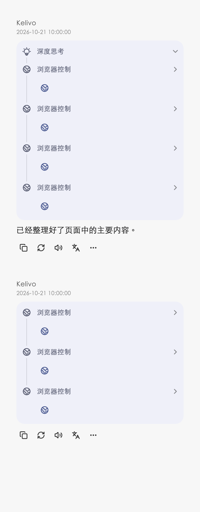
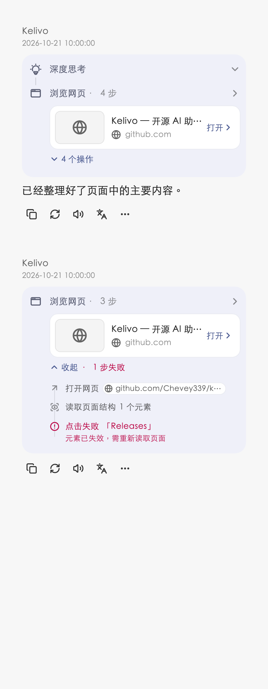
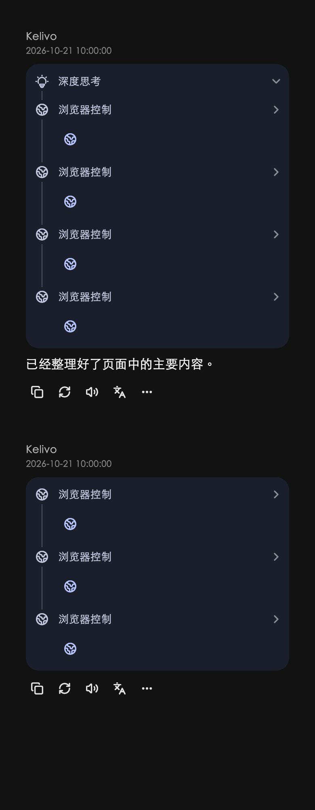
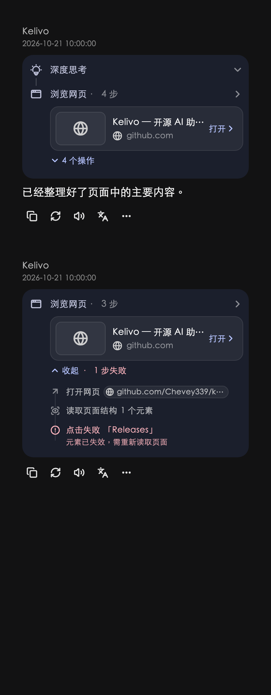
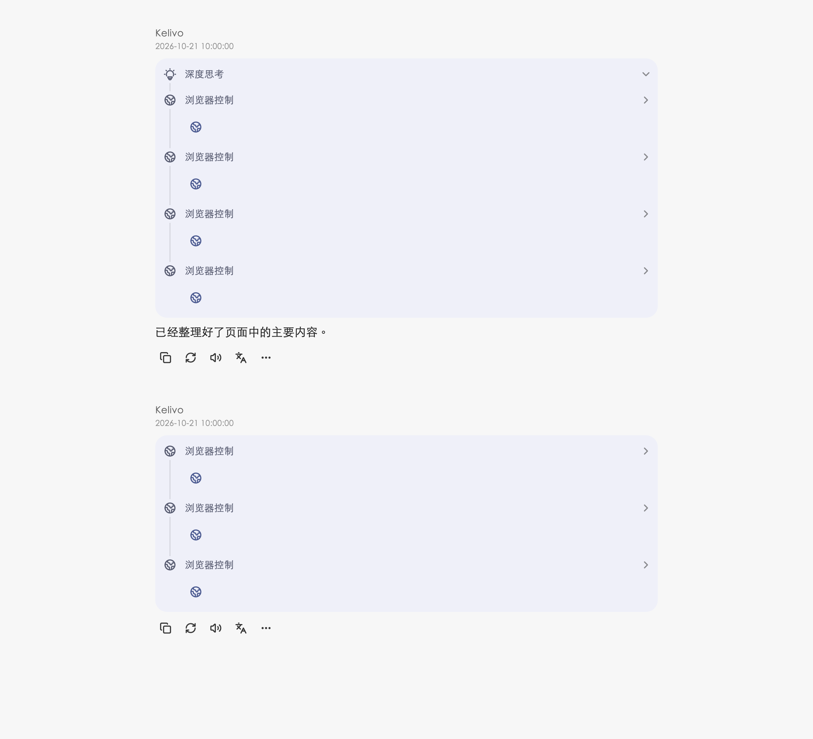
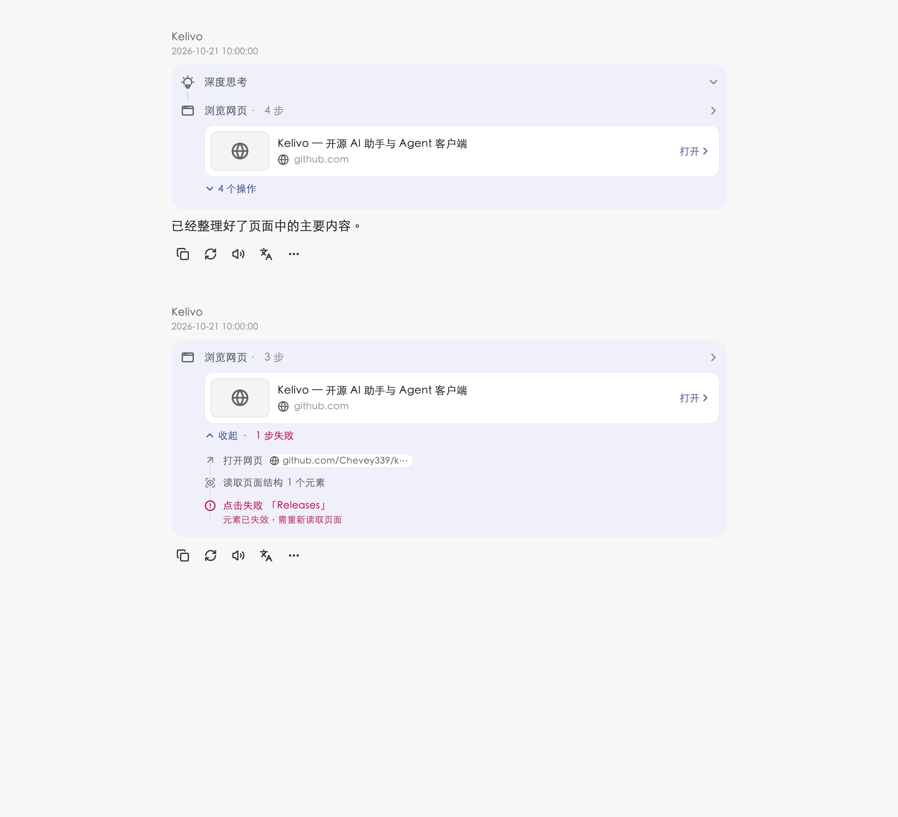

# Chat browser page cards

Adjacent browser tool calls now appear as one “Browsing · N steps” timeline
step. Its page card opens the last referenced tab and shows cached pixels,
title and site identity. Reasoning, other tools and pending approvals break a
group; only the last browser group in each thinking card has a thumbnail and
expandable action list. Running/failed groups start expanded, with no persisted
expansion state or invented elapsed time.

The renderer and lazy-list height estimator share `groupAdjacentBrowserSteps`.
Grouping runs after visibility/approval filtering and before the existing
last-two-step collapse. The estimator includes the compact/full body, default
expanded actions and permitted screenshot rows. Other tool and reasoning
rendering is unchanged.

Cards read existing `BrowserService` previews/favicons only. They never create
or wake a renderer or request a screenshot. Unrelated browser notifications
reuse the page-card widget; streaming updates reuse parsed unchanged results.
Tool image visibility still controls tool screenshots independently of the
page preview. Malformed results render a fallback without throwing.

Browser navigation was removed from the mobile Tools sheet and desktop Tools
popover. Phone More (+) retains it; tablet/desktop use the attachment action
area and its Add (+) overflow menu. The Tools button now depends only on model
tool capability; browser navigation does not. Browser control permissions and
the network-search globe icon are unchanged. The browser icon is AppWindow.

## Visual comparison

These are Flutter widget captures using the same local fixture, not physical
device captures. Before uses the message renderer from `8c57d7a3`; after uses
this change. The fixture deliberately has no live WebView or network favicon,
so it demonstrates the cached-preview fallback. Native browsing and snapshot
capture policies were not changed. Visual reference: the supplied `card-a.html`.

| Layout | Before | After |
| --- | --- | --- |
| Phone, light |  |  |
| Phone, dark |  |  |
| Desktop |  |  |

Reproduce the captures with a local CJK font; no font is installed or bundled:

```sh
flutter test test/perf/browser_page_card_preview.dart \
  --dart-define='CARD_PREVIEW_FONT=/path/to/CJK-font.ttf' \
  --dart-define=CARD_PREVIEW_OUTPUT=build/browser-card-preview
```

## Validation

Focused coverage includes adjacency, reasoning/approval boundaries, lite-card
selection, grouped collapse counts, operation/error labels, malformed results,
nearest-snapshot element names, loading/failure/placeholder states, cached image
updates without capture, explicit expansion across streaming updates, screenshot
visibility, tab selection and closed-tab fallback, and model-independent desktop
navigation both directly and in overflow. Existing non-browser timeline tests
remain part of the full suite.

This browser branch predates the Markstream migration. Its package checks are
run separately in the main checkout as required; they do not establish a
Markstream/browser merge or a device-runtime result.
