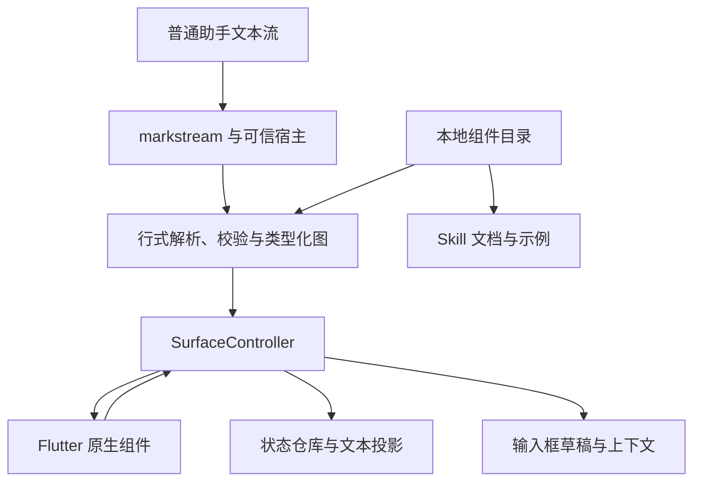

# Kelivo IntelligentUI 技术方案：原生组件、精简 DSL、一次完整交付

> 修订日期：2026-10-23（America/Los_Angeles）\
> 核验基线：`Chevey339/kelivo@e06ba9dec55958404ba37951cd63396559a9f7e8`；该提交时间为 2026-10-23 02:17 PDT。本轮核对了上一基线 `58d9badf` 至此的增量；旧版恢复验证仍固定使用 `58d9badf` 的 v3 源码。\
> 本文为第四版实施方案：保留 26 步与原生组件范围，精简 Windows 预览、统一 CSP/sandbox、明确 WebRTC 残余风险，并把旧版恢复与真实模型评测限定为手动开发验收。当前仅完成源码核验和设计评审，未实施功能、运行 Flutter/Windows 构建、执行真实旧客户端恢复或进行真实模型评测。\
> 交付约束：一个独立 git worktree、一条分支、一次完整交付；不拆 PR，不加运行时功能开关；每步一个 commit，每个 commit 独立编译，提交前 review。

## 1. 最终决策

**可行。采用“Kelivo 原生组件目录 + 精简行式 DSL + 本地状态与计算 + markstream 接入 + 按需 Skill”，WebView 仅提供范围明确的补充预览。**

本次把“完整”定义为：选定的常用场景从模型生成、原生展示、交互、状态保存，到复制、朗读、搜索、导出、fork 和备份恢复，全部闭环。组件范围保持克制；移出的能力不作为本项目后续阶段承诺。

核心决策：

1. 模型在普通助手回复中输出 `kelivo-ui` fence。一个 fence 对应一个界面，使用 Kelivo UI DSL v1；完整声明到达后即可逐步显示。
2. Kelivo 自己拥有组件契约、主题、交互与状态。Flutter 原生控件承担主路径，图表通过受控的 `fl_chart` 封装实现。
3. 内部使用类型化组件图、状态路径和依赖图。借鉴 OpenUI 与 A2UI 的适用思想，但本次不实现完整 OpenUI Lang、不引入未发布 A2UI Dart 包、不做 A2UI 导入适配。
4. 限定为 21 种原生组件、五类常见图表、有限表格和有界公式计算。删除地图、通用 Scene2D、物理仿真、通用关系图布局等。
5. 原生主路径覆盖 Android、iOS、macOS、Windows、Linux。`kelivo-ohos` 不在本仓库本次范围。
6. Web 预览覆盖 Android、iOS、macOS、Windows，均仅在用户主动打开时创建受限的自包含预览；Windows 将 `webview_windows` 放入 `dependencies/` 维护最小受限预览 fork。只有 Linux 使用摘要、源码、复制和导出，不新增 Linux WebView 包。
7. 本地操作不请求模型、不自动附带状态。只有用户点击“附带当前界面状态”或 Ask 才创建可见、可删的固定状态 chip；对话动作和“修复界面”先进入可编辑草稿，由用户发送。
8. 先完成纯 Dart catalog、parser、求值器和内存 controller，再以其规范化快照确定存储。Drift 从 3 直接升到 5，跳过未发布的 4，`minimumReadableSchemaVersion` 保持 2；一张新增业务表及派生索引完整接入消息、fork、合并和加密备份。
9. C09 即接上原生 builder、UiHostScope 与焦点策略；内置 Skill 和模型能力提示在全部运行能力完成后注册。真实模型调用仅为本次开发的手动检查点，普通测试和 CI 只回放脱敏夹具。

基线已包含 `dependencies/markstream`、`markdown_surface_scope.dart` 和加密备份提交 `58d9badf`。增量 `e06ba9de` 包含 Windows 恢复重试及 MCP 管理改动，未改变本方案使用的数据库版本、最低可读版本或归档格式。GenUI 不再等待 markstream 合入，也不在 gpt_markdown 上开发。[K1][K2][K3][K22]

## 2. 本次如何删减：成本与价值判断

| 能力 | 决策 | 成本与价值判断 | 本次替代方式 |
| --- | --- | --- | --- |
| 地图、标记、路线几何、区域着色 | **删除** | 涉及底图服务、资源缓存、手势、定位语义和平台维护；当前主要场景不依赖它 | 普通文字、表格或现有链接；删除 `flutter_map`、地图示例、目录与验收，不留空接口 |
| 通用 Scene2D、可拖动几何、二维场 | **删除** | 坐标、命中、约束、语义和导出会形成独立绘图产品 | 原生 Chart 展示有限参数曲线 |
| 物理仿真、时间轴、Play/Pause/Step 引擎 | **删除** | 时间推进、暂停恢复、离屏调度和确定性测试明显扩大工作量 | 参数变化后直接重算有限结果；无通用 tick |
| 通用 Diagram/Node/Edge 自动布局 | **删除** | 布局、文字测量、边路由和选中行为成本高，和已有 Mermaid 有重叠 | 继续使用现有 Mermaid 路径；不把 Mermaid 宣称为本次原生组件 |
| 雷达、热力、金融图、仪表盘；图表缩放/平移/刷选联动 | **删除** | 专用坐标与交互场景多，首批常用任务价值有限 | 折线、面积、柱状、散点、饼/环；图例、tooltip、点选、数据替代 |
| 大表格双向虚拟化、单元格编辑、服务端分页 | **简化** | 容易演变成电子表格或数据查询系统 | 有限标量数据、固定行 key、本地排序/文本筛选/分页 |
| 通用 Grid、Tabs、Accordion 和多级容器 | **简化** | 增加布局组合、焦点与状态恢复的测试面 | Column、Row、Section；窄屏 Row 自动纵排 |
| 多选、日期选择、范围滑块、富文本编辑 | **删除独立组件** | 对初次目标场景贡献小，边界与交互分支多 | 单选、普通输入、两个 NumberField 等已有组合 |
| Image、Code、Citation 等重复内容组件 | **不另建** | 已有 Markdown 能表达，多建一套增加渲染与导出维护 | 使用受限 Markdown 内容；不递归激活 UI |
| 任意函数、通用 map/filter、循环、CSS、事件脚本 | **删除** | 把 DSL 变成语言运行时，难控制性能与模型质量 | 白名单纯函数、条件表达式与专门的有限 `@sample` |
| A2UI 导入、完整 OpenUI 兼容、跨回复 patch | **删除** | 没有本次实际输入来源；适配、版本及状态合并成本高 | 一份明确的 Kelivo DSL v1，修改生成新回复或新 revision |
| UI 内工具执行、网络查询/写入、自动发送 | **删除** | 引入权限、结果生命周期及跨 provider 行为 | 本地计算；Ask 只准备可见草稿 |
| 全套插件生态、远程 catalog、组件热下载 | **删除** | 没有首批需求，维护和版本协商成本高 | 随应用发布的单一 catalog |
| 通用 isolate/worker 管理器 | **不建** | 小规模计算尚无测量证据需要；增加序列化和取消逻辑 | 数据上限、操作预算、局部更新；只有实测阻塞才定位优化 |
| 展开视图 | **保留并简化** | 手机图表、表格收益明显；已有页面容器可复用 | 同一 surface 的原生展开页/桌面对话框，无独立工作区 |
| 五平台交互 WebView | **保留四平台，Linux 简化** | 用户明确需要 Windows 预览；接受受限插件维护成本，不扩展成通用浏览器框架；Linux 接入成本仍偏高 | Android/iOS/macOS/Windows 同一 CSP/sandbox 契约，接受明确的 WebRTC 残余风险；Windows 最小 vendored fork；仅 Linux 文本与源码 |
| Web 状态回传、持久化、桥接工具 | **删除** | 又形成一套状态与动作系统 | 自包含临时预览；关闭释放，重开初始化，明确说明 |
| fork、备份、恢复合并、删除级联 | **保留** | 用户已输入的数据不应因现有操作丢失；可以复用现有生命周期 | 一表状态 + 现有快照/加密/合并规则 |
| 复制、TTS、搜索、导出、RTL、l10n、Semantics | **保留** | 属于常用功能可用性的基础，不是高级组件 | 目录定义语义文本，接入现有应用通道 |
| 全部历史卡片先点“激活”才能操作 | **不采用** | 增加每次使用摩擦，本次已删除持续仿真等高成本任务 | 普通历史控件直接可用；重绘和大数据视图按需要局部治理 |

这份范围不再含 L1–L6 的后续交付路线。内部按可编译 commit 逐层实现，最终一次验收本表保留的全部能力。

## 3. 对评审意见的采用与修正

| 评审意见 | 处理 |
| --- | --- |
| 更新到最新 markstream 与加密备份基线 | 采用，本轮增量核对至 `e06ba9de`；旧 reader 单独固定 `58d9badf`；实施开始前再次确认 master 差异 |
| 使用行式 DSL | 采用精简自有 DSL，但不先认定它比 JSON 更易生成正确；早期用真实模型验证 |
| A2UI 作为导入层 | 本次直接移除，不保留待实现 adapter |
| 扩展 `MarkdownSurfaceScope` 承担 UiHostScope | 不采用。该类只管理视觉表面；保留视觉职责，另加轻量可信宿主 scope |
| 状态通过可见 chip 回传，动作先预填 | 采用并简化为显式附带；点击附带/Ask 时冻结，后续拖动不增加或改写 chip，排队/重试沿用该快照 |
| 一张 Drift 表、完整生命周期 | 采用；先内存 controller 后存储，复用 `message_rows.id`；schema 直接 3→5、最低可读保持 2，严格保持纯增量结构 |
| 暂缓 fork、合并、备份完整性 | 不采用；这是保留能力的完整性要求 |
| 先只验证桌面加一个移动平台 | 不采用；五平台原生主路径在同次交付完成 |
| 保留并精简 Windows Web 预览 | 采用；共享现有 environment，内容存储隔离统一依赖 opaque-origin sandbox；保留同步导航取消、限定来源的资源过滤与 Close。C20 构建/插件单测，C21 真实运行验收 |
| 结构化输出 schema 用于修复或 UI 工具 | 明确边界，但本次不新增这两类专用模型调用；普通 DSL 回复和修复均不受供应商 JSON Schema 强约束 |
| 真实模型评测与常规测试分开 | 采用；`tool/genui_eval.dart` 仅手动运行，C06 后早期检查、C25 最终验收；≥95% 只约束本次交付。正式记录仅模型 ID、日期、受测 commit、成绩，离线回放保留在 `flutter test` |
| 旧版恢复验证脚本化 | 采用；`tool/legacy_restore/run.sh` 在临时目录运行冻结 v3 源码，C13/C26 各手动一次；不进入 G、CI 或默认 `flutter test` |
| 提前看到真实 UI | 采用；输入组件之后 C09 单独接入生产 builder、可信 host 与焦点链，内置 Skill 到 C23 才注册 |
| 拆分旧 C02 / C16 | 采用；完整 schema 与 repository 接线分为 C10/C11，复制/TTS 与搜索分为 C17/C18；不拆出半完成的数据库版本 |
| iOS/macOS/Windows 没环境也记为通过 | 不采用；明确构建负责人、runner 和真机记录要求，未分配执行环境即标记阻塞 |
| AGENTS 的分层原则意味着必须分 PR/分批发布 | 不作此解释。内部可编译的提交顺序满足渐进实施，最终交付形态遵循用户明确要求 |

A2UI 的 `updateComponents` 可以仅带一个组件，因此 JSONL 同样可以逐组件显示；“完整 JSON 记录才提交”不妨碍渐进渲染。OpenUI 的语句又可以跨物理行，不能直接把上游描述成“一物理行一条语句”。本方案主动采用更小、边界更明确的语言，省去不需要的协议层，但也承担自己的 parser 和类型检查维护。[A1][R1][R2]

## 4. OpenAI 与其他项目：借鉴的范围

OpenAI 公开资料可以支持“统一的组件视觉、内容优先、局部交互、明确动作与合适的展示容器”这些设计原则。ChatKit 提供声明式组件与动作；Apps SDK UI 提供 React 组件及语义 tokens。它们可作为 Kelivo Flutter 设计系统的参考，但不能据此推断 ChatGPT 所有可视化的私有渲染架构。公开第三方 Apps 的 iframe 路径，也说明良好体验并不等于所有内容都由同一种原生 renderer 实现。[O1][O2][O3][O4]

本次具体借鉴：

- **视觉**：延续 Kelivo 当前主题，使用语义前景、表面、边框和焦点状态；减少装饰性卡片套卡片。图表以清晰刻度、单位和说明为中心。
- **交互**：控件修改后本地即时反馈；清楚区分修改参数、重置和发起下一轮对话。
- **呈现**：回复正文先给有用结论，UI 用来探索；窄屏可展开，复杂度不挤进消息列表。
- **一致性**：同一个控件在不同模型输出中具有相同尺寸、校验、键盘和无障碍行为。

| 参考项目 | 本次吸收 | 不直接引入 |
| --- | --- | --- |
| OpenUI | 声明、引用、状态与派生值，catalog 与提示内容同源，完成声明/待定尾部分离 | 完整位置参数语言、Query/Mutation、编辑合并、React renderer |
| A2UI | 组件图、路径绑定、图校验的思路 | Dart SDK、wire 兼容、surface 消息生命周期 |
| OpenIntelligentUI / ZCode | Skill 指导、可见模型上下文与本地状态的区别 | HTML 作为常用组件主路径，完整工具运行时 |
| DEEIX Chat | 声明式组件与专用兜底分开，受限计算和状态投影 | 原样复制另一客户端的组件协议 |
| DSH 社区实现 | artifact 身份与宿主边界 | 将社区协议说成 OpenAI 内部实现 |
| SwiftChat-Public | 已公开宿主适配代码的交互思路 | 从公开仓库推断闭源应用的完整引擎 |

这些是工程参考，不构成本次兼容性承诺。[R3][R4][R5][R6][R7]

## 5. 本次原生组件与场景

### 5.1 固定 21 种组件

每种组件必须具备：属性契约、builder、状态行为、错误行为、语义文本规则、l10n/Semantics 要求和一个可执行示例。组件数量只是范围边界，验收以组合场景为准。

| 类别 | 组件 | 必须完成的行为 |
| --- | --- | --- |
| 布局（4） | `Column`、`Row`、`Section`、`Divider` | 主题间距、约束宽度、窄屏重排；Section 标题，不提供任意 CSS |
| 内容（6） | `Text`、`Markdown`、`Formula`、`Metric`、`Badge`、`Callout` | 字体缩放、文字选择、单位/数值格式、深浅色；Markdown 不激活嵌套 UI |
| 输入（7） | `TextField`、`NumberField`、`Slider`、`Switch`、`Checkbox`、`Select`、`RadioGroup` | 双向绑定、焦点、键盘/IME、disabled/error；TextField 以属性支持有限多行 |
| 表单/动作（2） | `Form`、`Button` | 必填、数值范围、字符串长度和条件显示；Ask/Reset；不加任意正则执行 |
| 数据（2） | `DataTable`、`Chart` | 下述有限数据能力、文字替代、导出快照 |

通用属性只保留 `visible`、`enabled` 等有明确语义的字段。宿主负责字体、颜色、圆角、响应式和危险操作外观；模型不能指定任意像素布局或任意颜色。Section、Callout 可选择少量语义 tone。

### 5.2 Chart 与 DataTable 的边界

**Chart：**

- `kind` 为 `line / area / bar / scatter / pie`；`pie` 可设 donut 外观。
- 笛卡尔图使用有限记录数组、`x` 字段及最多四个 `y` 字段；数值 x 保留坐标，字符串 x 按原顺序作为类别。scatter 必须使用数值 x。
- pie 只接受一个数值字段，值非负且总和大于零；不把负值悄悄取绝对值。
- 图例、tooltip、点选、标签、单位和数据视图进入本次范围；点选只影响当前图表，不建立通用跨组件刷选系统。
- 禁止默默截断数据或填零。空数据、缺值、定义域错误都有可读状态。
- 数值格式由宿主控制；时序标签可由模型提供，当前不做时区推断或时间轴框架。

**DataTable：**

- 有限记录数组，标量单元格；明确唯一 `rowKey`，不以排序后的行序号作身份。
- 本地稳定排序、可见文本筛选、分页；默认每页 10 行，可选 20 行。
- 保留表头和当前操作状态，提供无障碍排序描述。窄屏允许局部横向滚动。
- 本次不实现编辑单元格、冻结列、远程数据源、二维虚拟化。
- 图表“查看数据”复用同一表格能力，不建设第二套数据浏览器。

### 5.3 六个交付场景

| 编号 | 场景 | 必须证明 |
| --- | --- | --- |
| S1 | 三个参数的计算器 | 输入/滑块联动，结果本地更新，单位明确，重启后保留用户值 |
| S2 | 参数函数曲线 | 有限采样、定义域缺口、图表与数据表一致，拖动不请求模型 |
| S3 | 多系列趋势或分布图 | 正确图型与字段映射，图例、tooltip、点选与数据替代可用 |
| S4 | 方案比较表 | 稳定行 key、排序/筛选/分页、窄屏与大字可用 |
| S5 | 条件表单 | 隐藏字段保留值但不参与当前必填校验；无效提交被拦截，焦点与 IME 正常 |
| S6 | 组合界面与继续提问 | 同一界面包含表单、结果、图表/表格；Ask 形成可编辑草稿及可删上下文；发送后历史快照不变 |

六个场景在五个平台均以原生主路径完成，WebView 实例数为零。另测五类图型、每个控件及异常夹具，避免只验收六张“完美截图”。

## 6. 最小架构与代码归属



文件按现有 feature-based 结构组织，主要代码放在 `lib/features/intelligent_ui/`。不向 `chat_message_widget.dart` 或 markstream parser 塞入业务运行时。[K4]

建议少量模块：

| 模块 | 责任 |
| --- | --- |
| `catalog/` | 类型化组件/函数/动作描述，默认值、语义文本策略、示例模板，生成 Skill 参考 |
| `protocol/` | lexer/parser、完整行归约、IR、引用/类型/环与预算检查 |
| `runtime/` | 纯表达式、输入绑定、依赖通知、SurfaceController |
| `widgets/` | 原生组件、主题映射、只读/展开外壳 |
| `host/` | UiHostScope、markstream block adapter、草稿动作、文本投影和 Web 预览接入 |
| 数据层 | `lib/core/database/` 下新增状态 repository，复用既有消息/备份服务 |

不新建 provider/agent 会话层。模型供应商适配、消息流、重试和工具体系继续由 Kelivo 原实现负责。

实施依赖固定为 **catalog → parser → 纯表达式 → 内存 controller → 数据库及生命周期**。catalog 元数据、IR、parser、求值和状态快照保持可由纯 Dart 使用，不能经 barrel export 间接引入 Flutter builder 或平台插件；这使手动评测脚本与离线解析测试无需启动 UI。先在 controller 中完成初值、overrides、Reset 和规范化快照，再把该快照接入 Drift，不为尚未确定的运行时预设复杂存储抽象。

## 7. Kelivo UI DSL v1

### 7.1 语言边界

首行固定为：

```text
ui 1 catalog "kelivo.native/1"
```

之后每个**物理行**恰好一条声明，空行允许。字符串采用 JSON 双引号和转义，实际换行必须写成 `\n`；不支持跨行表达式、行注释、分号、隐式补括号或同名声明覆盖。

三类声明：

```text
$a: number = 2
let result = $a * 5
resultCard = Metric(label="计算结果", value=result)
```

- `$name` 为可写标量状态，类型 `number / string / boolean`，`?` 表示可空，初值必须是 JSON 标量。
- `let name` 为只读派生值，可以是标量、对象或有限数组。
- `id = Component(...)` 为组件，属性全部具名。
- `root` 必须显式声明为根组件，建议先输出根的 child 引用，再逐项补齐。
- 名称在状态、派生值、组件间全局唯一；保留 `root` 等关键字；标识符使用 ASCII，展示文字可用 Unicode。
- `bind=$a` 是可写路径；`value=$a` 只是读取；`bind=($a*2)` 非法。
- 裸组件引用只在 catalog 声明的引用槽合法；不能把组件当算术值。引用区分结构 children、表单关联等类型：children 构成单根树，不允许同一控件被两个父节点同时挂载；`Button.form` 是非结构 FormRef，不参与布局环检查。表单内部的提交按钮可以关联所属 Form，不能被误判为环。
- `Ask(...)`、`Reset()` 是 action 槽的类型化描述，不是表达式函数。

### 7.2 可实现的最小语法

下面省略空白和 token 定义，实际 parser 必须消费完整记录，不能默默忽略尾部字符。

```ebnf
document     = header, LF, { declaration, LF | LF }, [ declaration ], EOF ;
header       = "ui", integer, "catalog", jsonString ;
declaration  = stateDecl | valueDecl | nodeDecl ;
stateDecl    = "$", identifier, ":", scalarType, [ "?" ], "=", jsonScalar ;
valueDecl    = "let", identifier, "=", expression ;
nodeDecl     = identifier, "=", componentName, "(", [ namedArgs ], ")" ;
namedArgs    = namedArg, { ",", namedArg } ;
namedArg     = identifier, "=", slotValue ;
slotValue    = expression | actionSpec ;
actionSpec   = "Ask", "(", "text", "=", expression,
               ",", "context", "=", expression, ")"
             | "Reset", "(", ")" ;
expression   = conditional ;
conditional  = logicalOr, [ "?", expression, ":", conditional ] ;
logicalOr    = logicalAnd, { "||", logicalAnd } ;
logicalAnd   = equality, { "&&", equality } ;
equality     = relational, { ( "==" | "!=" ), relational } ;
relational   = additive, { ( "<" | "<=" | ">" | ">=" ), additive } ;
additive     = multiplicative, { ( "+" | "-" ), multiplicative } ;
multiplicative = unary, { ( "*" | "/" ), unary } ;
unary        = ( "!" | "-" ), unary | primary ;
primary      = jsonScalar | "$", identifier | identifier
             | "(", expression, ")" | array | object | pureCall | sampleCall ;
pureCall     = "@", functionName, "(", [ expressionList ], ")" ;
sampleCall   = "@sample", "(", identifier, "=>", expression,
               ",", expression, ",", expression, ",", expression, ")" ;
array        = "[", [ expressionList ], "]" ;
object       = "{", [ jsonString, ":", expression,
               { ",", jsonString, ":", expression } ], "}" ;
expressionList = expression, { ",", expression } ;
scalarType   = "number" | "string" | "boolean" ;
```

表达式优先级从高到低：一元 `! -`；`* /`；`+ -`；比较；等值；`&&`；`||`；条件 `?:`。同级数值运算左结合，条件表达式右结合。`&& / || / ?:` 短路求值，未选中的分支不能产生求值副作用或定义域错误。

只提供纯函数：`@abs`、`@min`、`@max`、`@round`、`@clamp`、`@pow`、`@sqrt`、`@sin`、`@cos`、`@formatNumber` 和下述 `@sample`。具体参数/返回类型来自 catalog。不提供文件、网络、时钟、随机、工具调用、任意成员访问、用户函数或通用循环。

数值为有限 double，数字字符串和 null 不做隐式数值转换；除零、NaN、Infinity、溢出均诊断。显示舍入不改写业务值。不宣称任意精度计算或财务级精度。

### 7.3 有限函数采样

```text
@sample(x => expression, start, end, count)
```

仅此处允许一个局部数值变量：

- `start < end`，count 为有界整数，包含两个端点。
- body 可读本 surface 的输入与派生值；禁止嵌套采样。
- 返回有限 `[{"x":number,"y":number|null}, ...]`。
- 定义域错误生成 `y:null` 和可见诊断；曲线留缺口，不填零，不跨错误点连线。
- 采样数、表达式深度和总操作量均受预算约束。

这足以完成参数曲线，无需引入通用集合编程和仿真引擎。

### 7.4 自洽的组合示例

以下是**拟定义的 Kelivo catalog 契约**，不是 OpenUI/A2UI 的现成语法。每条声明占一个物理行；编辑器视觉折行不影响协议。

```kelivo-ui
ui 1 catalog "kelivo.native/1"
root = Column(children=[controls,result,chart,table,ask,reset])
$a: number = 2
$b: number = 1
$useOffset: boolean = true
let offset = $useOffset ? $b : 0
let yAt5 = $a * 5 + offset
let points = @sample(x => $a * x + offset, 0, 10, 21)
controls = Form(children=[slope,offsetToggle,offsetInput])
slope = Slider(label="斜率 a", bind=$a, min=-5, max=5, step=0.1)
offsetToggle = Switch(label="启用截距", bind=$useOffset)
offsetInput = NumberField(label="截距 b", bind=$b, min=-20, max=20, visible=$useOffset)
result = Metric(label="x = 5 时的 y", value=yAt5, digits=2)
chart = Chart(kind="line", data=points, x="x", y=["y"], xLabel="x", yLabel="y")
table = DataTable(data=points, rowKey="x", columns=[{"key":"x","label":"x"},{"key":"y","label":"y","digits":2}], sortable=true, filterable=true, pageSize=10)
ask = Button(label="解释当前参数", form=controls, action=Ask(text="解释当前直线参数与图形的关系。", context={"slope":$a,"useOffset":$useOffset,"offset":offset,"yAt5":yAt5}))
reset = Button(label="重置参数", action=Reset())
```

`visible=false` 不丢弃字段值，但该字段不参与当前 Form 的必填校验。`Button.form` 引用的表单或 Ask.context 的依赖无效时，该动作禁用。

NumberField 的暂态文本（空串、`-`、尚未完成的小数、IME composing）保留在控件草稿中，不强制转换成 0。DSL 有效与表单当前有效是两个维度。

### 7.5 结构化输出的适用边界

正常 Markdown 回复中的 DSL fence **不受整条回复 JSON Schema 的供应商约束**。本次 catalog 生成的是类型签名、校验元数据、文档和 few-shot；JSON Schema 如有产物，只用于对应 JSON 数据的本地验证。

本次没有 UI 专用 tool 或纯 JSON 响应路径。“修复界面”仍走普通可见聊天，不能写成“修复已有强 schema 保证”。即使未来使用 `{"source":"DSL"}`，schema 也只能保证 source 是字符串，不能验证里面的 DSL。

## 8. 流式解析、markstream 与局部错误

### 8.1 接入点与可信宿主

在 `lib/shared/markdown/kelivo_markdown_extensions.dart` 的稳定 `codeBlockBuilders` 注册 `kelivo-ui`，不要把业务语言嵌入 markstream parser。

`MarkdownSurfaceScope` 继续提供 frosted/solid/tinted 和背景信息。新增轻量 `UiHostScope`，仅在受信的助手主回复入口提供：

- conversation/revision 身份、原始 TextPart 映射、块定位；
- 生成完成/取消/失败状态；
- 草稿动作入口；
- 正常交互或只读导出模式。

用户粘贴的代码、工具输出、引用/搜索预览和组件内部 Markdown 都不因此自动激活 UI。没有可信 scope 时按普通代码显示。视觉上下文不等于动作权限。[K2][K5]

连续 TextPart 可以按现有展示逻辑组成一个 text run，但不得跨越图片、文件、工具边界；保留 run 到原始 part 的映射。块定位采用“run 首个原始 part ordinal + run 内 UI fence ordinal”，不使用显示列表索引或数据库自增 part_id。

### 8.2 增量边界

markstream 的 `CodeBlockNode` 已有 `code`、span、`closed`；closed 来自真实 fence closer。`IncrementalDocument` 尚未提供专用 append/reset 事件，开放尾块仍会重解析。[K5][K6]

实施先做短 spike，覆盖：

- opener/closer 被任意分片，闭合标识与宿主完成状态不同步；
- CRLF、Unicode、列表/引用缩进及围栏缩进；
- 非追加改写、截断、取消、重新生成；
- `node.code` 规范化后的偏移与原始 source 映射。

默认方案是 block adapter 比较前后 `node.code`：追加时只喂未消费后缀；已消费前缀变化时推进运行期 epoch 并重建。parser 不放在 widget build 中归约。不能因 markstream 重建节点重复消费声明，也不能用“相同行文本哈希”误去重两个不同源码位置的声明。

LF/CRLF 统一规范化并维护尾部 CR；最后一条无 LF 的完整声明只在实际 fence 闭合后提交。流结束但 fence 未闭合仍属 interrupted。`closed` 与“宿主正常生成完成”同时满足后才开启交互。

只在 spike 证明现有接口不足时，在接入 commit 中补充最小、通用的追加/重置能力及测试；不预先建设新的事件协议。不能承诺端到端 O(delta)：尾块重解析、字符串比较本身仍有成本。

### 8.3 状态与错误域

| 状态/错误 | 展示与交互 |
| --- | --- |
| `streaming` | 已完成声明逐步展示，前向引用显示待定占位，整体只读 |
| `complete` | 可靠根和依赖成立，开启交互 |
| `completeWithErrors` | 出错节点显示说明；无关健康子树可用；依赖错误的表单/动作禁用 |
| `interrupted` | 保留只读预览和源码，提示中断，不当作正常完成 |
| `invalid` | header/catalog/root 不可信，整块降为说明与源码 |
| 未知组件或属性 | 错误局限在相应节点，不让整个消息失败 |
| 重复符号、循环或失效派生值 | 隔离相关符号及依赖区域，不采用“后者覆盖”或默默置零 |
| 完成后仍缺少引用 | 待定占位转明确错误；保留其余独立分支 |

“每写完一条语句显示”指完整记录可被提交；它仍可能等待子节点/数据，长数组也仍须等该行完成。首个空骨架不算首次有效展示。

“修复界面”收集有界错误码、行号和相关源码，生成可编辑草稿。用户发送后产生新回复或 revision；不自动重试付费请求，不后台修改原始消息。

### 8.4 C09 提前接入与手写验证

C07 完成布局/内容，C08 完成输入/Form/本地动作后，**C09 单独注册 `kelivo-ui` builder、UiHostScope 和消息列表焦点豁免**。此后每个 commit 都能在设备上通过手写 fence 验证当时已完成的能力，不必等内置 Skill 或真实模型调用。

开发预览使用独立的 Flutter 开发入口或 integration-test target，构造已完成的 assistant 消息夹具，挂载实际生产消息 widget、host 与消息列表焦点链；手写 DSL 放在该夹具中。早期使用内存 owner，模型调用关闭，动作可用本地可观测 sink 检查；这不是运行时发布开关，也不向生产用户提供“把用户消息变成可信助手消息”的入口。不能只测试孤立 Slider gallery，遗漏父 Listener 抢焦点的问题。

同一 fence 必须成对验证：可信 assistant fixture 能显示与输入；user/tool fixture、引用、嵌套 Markdown 和无 scope 路径仍为普通代码。C09 只声明已完成的本地渲染能力；Ask/composer 等尚未接线的动作明确不可执行，不用空回调假装成功。C16 接动作，C21 接 `kelivo-web`，C23 最后注册内置 Skill/模型提示。

## 9. 本地状态、动作与下一轮上下文

### 9.1 状态归属

持久身份为 `messageRevisionId + surfaceKey`，已完成源码的 `sourceHash` 用于兼容性校验；runtime epoch 只处理旧回调，不入数据库。

内部输入路径如 `/inputs/a`。默认值只在新 surface 初始化，rebuild、重新滚入视口或读取历史不能重置用户值。只存用户 overrides 和必要的有限视图设置，派生结果按声明重算。

C05 先实现只放内存的 controller，完成 `stateVersion=1`、`inputs`/`view` 规范化快照、默认值消除和还原测试；不依赖 Drift。C10 再按这个已实现的快照一次确定完整 v5 schema，C11 接可靠持久化。表结构、runtime epoch 和状态格式版本各司其职，不以 schema 版本代替 controller 的状态语义。

控制器以依赖图局部通知：拖动滑块只更新依赖结果，不触发整条消息或整个消息列表重建。没有表达式 IO，没有定时自动 Ask。

### 9.2 `modelContent` 与 `privateContent`

采用二者分工，不把它做成两个任意、可被模型随便写入的大对象：

| 内容 | 归属 | 规则 |
| --- | --- | --- |
| `privateContent` | 本地业务状态 | 输入 overrides、有限表格/图例设置；不含凭据；持久化有界状态 |
| `modelContent` | 宿主生成的语义投影 | 当前选定字段、单位和结果摘要，最大 4 KiB UTF-8；不含整棵 UI、源码、DOM 或历史事件 |

常规投影由 catalog 知道的输入标签和当前结果生成；输入与派生结果必须来自同一已完成状态批次，尚在重算时先完成本地批次，不能把新输入和旧结果混入快照。Ask 可以显式选择 context 字段，但仍接受类型、长度和依赖校验。过长时不能直接截断 JSON：按字段选择并明确标记省略，保留可查看的准确发送内容。

### 9.3 输入框中的上下文 chip

**只有用户点击“附带当前界面状态”或 Ask，才向草稿加入状态 chip。** 输入、滑动、排序、筛选、分页、浏览、Reset 都不会附带状态。删除“最近操作 surface”跟踪、自动附带及删除后抑制恢复等逻辑，保持一条清楚的显式操作路径。

点击附带时，宿主完成当前状态批次，捕获有界、不可变的语义快照；chip 显示来源与主要参数，可展开查看准确发送文本并删除。Ask 的文本与 context 同时捕获。**此后的 UI 变化不改写已有 chip**；用户要使用新值，需再次主动附带或 Ask。一份草稿最多带一个 surface；主动附带另一份或已有 chip 时，先显示替换预览，不静默替换。

点击发送、进入队列、切模型和失败重试都沿用已附带的同一快照，不重新读取 UI。草稿恢复只恢复用户明确保存的 chip，不扫描或推断“最近使用”的界面。来源 surface 删除或换源时，未发送 chip 标明来源已失效，由用户移除或重新附带；不能静默引用另一份状态。

草稿持久化复用 `ComposerDraftInput` / `ChatInputData` / 既有 draft store，完整更新 JSON 序列化、copy/merge/equality/isEmpty 与提交回执；尊重现有 owner/input epoch，不覆盖另一会话、输入法 composing 或用户已输入的草稿。[K7]

实际发送时把 chip 的人类可读文本作为普通用户 TextPart 的可见内容保存；用户气泡能看到相同信息，provider 无需新增 part 类型。模型历史只看到这份显式发送的快照，不会因后续拖动而变化。

### 9.4 两类动作

- **Reset**：本地恢复此 surface 默认输入与约定视图设置；清 overrides，保留搜索投影；不发送消息。
- **Ask**：根据当前有效表单，一次性捕获 text/context 的同一状态快照，生成可见、可编辑文本及固定 chip。输入框已有草稿时先提供合并/追加预览，不替换用户内容；最终始终由用户点击发送。

没有 `openUrl` 动作、工具调用动作或后台发送；普通 Markdown 链接沿用已有宿主行为。原生输入、排序、分页、重置不需要额外确认弹窗。

## 10. 数据库、消息生命周期与加密备份

### 10.1 固定的一表 schema

当前 Drift schema 为 3，`message_rows.id` 已是消息 revision；同一位置的修订另有 groupId/version。`message_part_rows.part_id` 在复制、导入时会重新分配，不能作为状态外键。[K8][K9]

先完成 C05 内存 controller，再在 C10 **一次确定完整 v5 schema**；C11 单独实现 repository 与可靠持久化接线。业务表建议名为 `gen_ui_surface_state_rows`：

| 字段 | 类型/约束 | 含义 |
| --- | --- | --- |
| `revision_id` | TEXT，FK → message_rows.id，ON DELETE CASCADE | 真实消息 revision owner |
| `surface_key` | TEXT | revision 内宿主生成的稳定块定位 |
| `source_hash` | TEXT | 规范化 DSL + catalog 版本的摘要，不含 owner ID |
| `state_version` | INTEGER，初值 1 | 持久状态格式版本，**不是**运行期写入序号 |
| `state_json` | TEXT，有界且校验 | 用户 overrides 与有限视图设置；默认 `{"inputs":{},"view":{}}` |
| `search_text` | TEXT，有界 | 完成生成时的语义文本投影；派生缓存 |
| `updated_at` | 现有 UTC 时间转换器 | 状态实际保存时间，不进语义指纹 |

主键为 `(revision_id, surface_key)`。不增加 conversation_id、独立 surface 文档表、事件表或新 revision 表。原 DSL 仍在 TextPart 中。

`search_text` 在消息 seal/finalize 时由纯 Dart 投影器生成，不依赖 widget 曾经挂载。即使没有 overrides 也可有投影行；Reset 清状态但保留该行。同一 owner、surface、source_hash 下，投影生成/修复/重建只更新 search_text 与索引，必须保留 state_json、state_version 和状态保存时间，禁止用默认状态整行 replace/upsert 覆盖用户值；只有源码变更才按换源规则失效。

新增一个普通存内容的 FTS5 **派生索引**，供 `search_text` 查询；它不是第二张业务状态表。INSERT、search_text 变化的 UPDATE、DELETE 三类触发器**只挂在 GenUI 自己的状态表上**，在同一事务内维护索引。父消息/会话通过 FK 级联删除状态行，再由状态表自己的 DELETE trigger 清索引，不能给旧消息/会话表添加 GenUI 触发器。只改 state_json 不重新分词；缺失/损坏可重建。不得修改现有正文 external-content FTS 定义或 `message_part_rows.payload` 语义，不新增依赖 GenUI 表的持久 view。[K9][K10]

这些限制是保持最低可读版本 2 的条件：旧 normalizer 会删未知表，却没有通用的未知 trigger/view 清理。挂在 GenUI 表上的索引和触发器会随表删除；不得留下引用已删除 GenUI 对象的旧表触发器。[K9][D2]

### 10.2 可靠写入

- 内存同步更新，持久化按短 debounce 合并；控制器暴露 `flush`。
- 一条串行写入队列按 owner/surface 管理最新值；运行期 epoch/序号拒绝过期写入。
- 保存时在**同一数据库事务**核对 revision 存在、源码摘要一致、状态类型有效并写入；不为补救写入而复活已删除消息。
- 应用进入后台、离开当前 owner、复制/fork、备份前 flush 已接受状态。复制/fork/备份的 flush 失败则停止该操作，保留待保存状态以供重试，不能悄悄复制旧值。
- 删除、同 revision 换源、clearAll 作废相关旧任务，并与数据库事务排序；epoch 只能拒绝尚未提交的任务，不能取消已经执行的 SQL。
- 覆盖恢复的解密、预检及用户可取消准备阶段不作废本地队列。验证通过进入数据库切换临界区后，停止接收旧 owner 新写入，处理已接受保存并等待已发出 SQL 排空；成功切换后清旧 runtime，切换失败继续使用旧库则恢复保存能力。
- 写入失败明确显示“尚未保存”；不能把内存已改的值宣称为已持久化。系统强杀的未完成 debounce 存在丢失窗口，设计上以提交/失焦/滑动结束 flush 缩小窗口。

### 10.3 生命周期完整表

| 事件 | 本次行为 |
| --- | --- |
| 新生成或新 revision | 按初值初始化，旧 revision 状态保留 |
| 同 revision 的源码重写 | 摘要不符的旧状态失效；不强套旧值 |
| 切换选中版本 | 切换到该 revision 的独立状态 |
| 删除消息/修订/会话、截断后续历史 | 级联删除状态与派生索引，取消待写任务 |
| 临时会话 | 仅内存，不为 GenUI 建持久消息；丢弃时清除 |
| duplicate | flush 后按新 revision ID 复制状态，source hash 保持 |
| 保留版本 fork | 复制实际保留的全部 revision 状态 |
| 默认 fork/从消息列表 fork | 复制被选中的 revision 状态，不能遗漏 service 层克隆路径 |
| 明文/本地自动/加密备份 | flush 后一致 SQLite 快照，状态自然进入现有归档 |
| 覆盖恢复 | 先完成认证/预检；只在切换临界区暂停旧写入并排空 SQL，成功后清旧 runtime，失败恢复旧库保存能力 |
| 恢复合并 | 语义状态参与会话指纹，按现有冲突复制策略重映射 owner |
| includeChats=false | 不备份消息，也不单独携带 GenUI 状态 |

代码必须同时覆盖 `duplicateConversation`、`forkConversationWithVersions → _copyMessageRowsInto`，以及 `ChatService.forkConversationAtRevision(preserveVersions:false)` / `forkConversationFromMessages → _cloneMessagesInto`。只改 repository 会漏掉默认 fork。[K9][K11]

### 10.4 合并语义：保留现有整会话策略

当前 merge 根据会话 fingerprint 去重；冲突时复制整段会话并确定性生成新 ID。无需新建字段级 LWW。[K9]

必须修改 `_conversationFingerprint` 和 `_insertMergedConversation`：

- 纳入存在非默认 inputs **或**非默认 view 的 surface_key、source_hash、state_version 与规范化状态，不能遗漏仅修改排序/图例的情况；
- 保存与指纹共用默认值归一化：移除等于声明初值/宿主默认视图的字段，手动改回默认与 Reset 等价；
- 稳定排序，对象 key 顺序无关；不纳入 updated_at、owner ID、epoch、FTS、search_text；
- 只有投影缓存、没有 overrides 的行，与不存在状态行在语义指纹中等价；
- Reset 后回到默认的空 overrides 不制造额外内容冲突；
- 复制/导入时重映射 revision ID，并同步或重建搜索索引。

两份正文相同、用户参数不同的会话会保留为冲突副本，这是沿用当前合并语义的明确取舍。测试须证明重复导入幂等，同值不同保存时间不制造副本。

### 10.5 schema 升级与加密接入

这是现有 Drift 的 **v3 → v5 数据库升级**，跳过未发布的 v4，不属于 AGENTS 所禁止的另建旧 UI 协议兼容层。沿用已有已发布 schema、升级前快照、验证和回滚流程，不在普通 open 路径偷偷迁移。[K4][K12]

版本约定固定如下：

```dart
static const currentSchemaVersion = 5;
static const publishedSchemaVersions = <int>{1, 2, 3, 5};
// schema_migrations.dart 中保持现有声明：
const minimumReadableSchemaVersion = 2;
```

Drift 2.34.0 生成器按实际存在的相邻 schema 快照生成迁移回调，支持直接 `from3To5` / `Schema5`；无需伪造 v4 快照或 `from3To4/from4To5`。同步把项目注释中的“fromNToN+1”改为“相邻已发布快照版本”。[D1]

**C10 原子完成全部 DDL：** Table 注册、current/published version、`from3To5`、普通索引、FTS/自有触发器、严格 requiredTables/列顺序/PK/FK 校验、新库创建与升级路径，以及 `app_database.g.dart`、`schema_versions.dart`、`drift_schema_v5.json`、测试 `schema_v5.dart` 和其生成索引。C11 只增加 repository 操作及 controller 接线，不再给同一个 v5 追加“下一步才创建”的必需表或触发器。保留已发布 v1/v2/v3 快照不变，不创建或发布 v4。

按仓库方式生成，不手写生成文件：

```bash
dart run build_runner build
dart run drift_dev schema dump lib/core/database/app_database.dart drift_schemas/app_database/
dart run drift_dev schema generate drift_schemas/app_database/ test/core/database/generated_schema/
dart run drift_dev schema steps drift_schemas/app_database/ lib/core/database/schema_versions.dart
```

测试新库、v1/v2/v3→v5、升级前快照与失败回滚。现有 unpublished 版本用例移除已发布的 5，继续验证 4 被拒绝且文件不被修改。**保持最低可读 2 的前提**是本次仅新增 GenUI 表及派生索引；不得改变现有表任何列的含义、值域或旧约束，GenUI 触发器只能挂在自己的表上。

备份 manifest 沿用现有结构，数据库 schema 写 5、minimum readable 写 2。archive 的 `backupFormatVersion` 与 `minimumReadableFormatVersion` 继续为 3，不随本次 schema 跳号修改；数据库最低可读 2 不等于任意历史二进制都支持当前归档格式。[K12][K13]

`58d9badf` 已将整个归档加密。GenUI 不新增 ZIP entry、加密算法或密码流程；复用 `database/kelivo.db` 快照，验证 portability 保留新表、备份前 flush 和覆盖恢复临界区。认证失败、用户取消不能产生部分恢复。[K3][K13]

### 10.6 旧 v3 导入 v5 备份：手动脚本验证

冻结旧基线 `58d9badfb0912bb01739a71d2dc26ed7deded90b` 的 v3 classifier 对未来 schema 5 且 declared minimum readable 2 判为 **forwardCompatible**；恢复处理解压后的临时副本，normalizer 删除未知表，再按旧 schema 校验。该判断可由源码确认，**实际恢复是否通过仍需实施验收**。[K9][K12][K13]

| 路径 | 预期结果 |
| --- | --- |
| v5 导入 v5 备份 | 正文、GenUI 源码、交互 overrides 和有限视图状态均保留 |
| 旧 v3 导入 v5 备份 | 会话/消息及正文中的 fence 保留；GenUI 表、派生 FTS/shadow tables/触发器被丢弃 |
| 从上述 v3 再导出并导入 v5 | 可由源码重建默认界面与搜索投影，无法找回已被旧版丢弃的 overrides |
| v5 再恢复原始 v5 归档 | 原归档未被修改，完整状态仍可恢复 |

这项兼容承诺针对**备份导入**，不承诺降级应用直接打开已安装的 v5 主数据库。changelog 说明旧版导入会舍弃新增 GenUI 状态，不写“旧版读不了新备份”。

C13 实现 **`tool/legacy_restore/run.sh`**；C13 提交后与 C26 最终验收各手动运行一次，记录受测新版本 commit、旧 reader SHA、日期、命令和结果。它不进入普通 commit 门禁 G、CI、git hook 或当前仓库默认 `flutter test`，两次结果作为本次交付验收证据；交付后不要求常态运行。当前正常的迁移、备份、forward-normalize 单测仍保留。

```bash
bash tool/legacy_restore/run.sh
```

脚本契约固定为：

1. 从脚本位置定位唯一开发仓库，启用 `set -euo pipefail`；用 `mktemp` 创建可写临时目录，`git archive 58d9badfb0912bb01739a71d2dc26ed7deded90b` 解压完整旧源码。退出只清理本次临时目录，日志写在其外，不建立第二个 git worktree/分支。
2. 将 `tool/legacy_restore/legacy_restore_v5_test.dart` 拷到临时旧源码的 `test/legacy_restore_v5_test.dart`，同时拷入 v5 备份夹具；从旧源码根目录依次执行 `flutter pub get` 与 `flutter test test/legacy_restore_v5_test.dart`。测试源放在 `tool/`，避免被当前默认测试发现。
3. v5 夹具必须由真实新版本备份导出链生成，使用合成数据，包含普通消息、多个 revision、GenUI fence、非默认 inputs/view 和搜索投影；不能仅修改旧夹具中的版本号。C26 使用最终实现生成的夹具复验。生成与验证使用 C01 锁定的同一 Flutter 可执行程序。
4. 只添加测试与夹具，不改旧生产代码、版本常量、generated schema 或 normalizer；不拷当前 `.dart_tool`、依赖覆盖或新 `lib/`。测试断言旧 `schemaVersion=3`、published={1,2,3}，package resolution 指向临时旧源码。冻结的是业务源码，临时目录仍允许生成 `.dart_tool`、锁文件和构建产物；缺旧 Git 对象、SDK、夹具或依赖失败均明确失败，不记跳过为通过。
5. 测试用独立临时应用目录与必要的平台路径替身，以**包含聊天的 `RestoreMode.overwrite`** 运行真实旧 `DataSync.restoreFromLocalFile`。该分支返回时仅准备好恢复包；随后关闭旧服务及连接，执行旧 `RestoreStartupGate.recoverAndRequireBusinessReady` 对应的启动恢复流程，再重开数据库，不能在准备阶段就宣称已完成覆盖恢复。[K23]
6. 断言 forwardCompatible、恢复后 `user_version=3`、旧严格校验通过，消息数量/正文/选中版本完整；GenUI 表、FTS/shadow tables 和触发器均消失，旧 repository CRUD 与 FK 检查正常，原始归档前后 hash 相同。不得 mock 掉 DataSync、normalizer、切换或数据库本身。

旧树没有提交根 `pubspec.lock`，本脚本证明的是**冻结 v3 业务源码的兼容性**，不宣称复现历史发布二进制的完整依赖组合。[K24] 只把新代码版本改为 3、只创建旧结构，或只运行当前 normalizer，都不能替代这项真实旧链验收。

## 11. 语义文本、复制、朗读、搜索与导出

### 11.1 一个纯 Dart 投影器

catalog 为每个组件声明文本模板/语义字段，生成统一分发与覆盖检查；具体图表摘要等需要手写语义实现，不能声称仅靠属性 schema 就能自动得到好文案。缺少文本策略的组件不能注册。

应用层 `UiTextProjection` 以 IR、已提交状态和模式生成文本，不依赖 widget、平台视图或模型再次解释：

- 输入：标签、当前值、单位；
- Metric/Formula：名称、当前结果和必要公式说明；
- Chart：图型、轴/单位、系列、数据范围与缺值说明；
- DataTable：表头及有界行文本；
- Form：当前可见字段与校验问题；
- 出错节点：简短人类可读诊断；
- 布局：阅读顺序与标题，不重复播报容器名。

模型仍必须在 UI 块外写可读结论。纯文本投影补全应用能力，不能替代模型对任务的回答。

### 11.2 各通道的接入要求

| 通道 | 本次规则与接入 |
| --- | --- |
| 消息复制 | 默认复制可读文字与当前 UI 语义文本；“复制源码/Markdown”显式保留原 fence，不修改存储的 TextPart |
| 选择复制 | 接入 mobile sheet/page、desktop dialog；原生文字参与选择。rich clipboard 对 UI 节点使用专门序列化，不能只做可视选择后仍输出原 CodeBlock |
| TTS | UI 投影在 `TtsTextSelection.apply` 之前完成；核对 `removeCode` 和 TtsProvider 的二次 Markdown 清理，避免整块被吞或重复剥离 |
| 全局搜索 | 搜索生成完成时的标签、语义摘要与预算内初始数据；当前滑块值不随每次拖动进入索引 |
| 会话内搜索/minimap | 纳入相同投影；命中导航到 revision/surface，不把投影字符 offset 伪装为原 Markdown offset |
| TXT/Markdown 导出 | TXT 为可读文本；Markdown 为可读说明加原 DSL，保留可检查性 |
| 图片导出 | `ExportCaptureScope` 下使用冻结状态的原生只读快照；无按钮动作、焦点、光标、WebView；超过尺寸预算明确提示 |
| 数据读取 | “查看数据”与文字复制复用有界表格；本次不另建通用 CSV/Excel/SVG 导出产品 |

当前选取复制分布在 `select_copy_sheet.dart`、`select_copy_page.dart` 和桌面 `select_copy_dialog.dart`；仅改聊天气泡的复制分支并不完整。当前 TTS 实际使用的函数名是 `removeCode`；评审中的 `markdownRemoveCode` 是问题描述，不应作为真实符号搜索的唯一依据。[K14][K15]

### 11.3 搜索必须端到端一致

现有全局搜索先在 SQLite 找候选，随后在 `GlobalSessionSearchService` 用 messageContent 再做 token 复核。仅新增 SQL union 但不改变候选文本，会把 UI 命中再次丢弃。[K9][K10]

具体设计：

1. 原文索引保持原样；新 UI 投影使用自己的派生 FTS，CJK 分支对 `search_text` 做相应 LIKE。
2. 多关键词按“每个 token 可命中标题/正文/UI 投影中的任一来源，再做 AND”组合；不能要求所有词必须落在同一个来源或同一个 surface。
3. role、selected revision、会话和 assistant 等过滤沿用现有语义；去重和来源合并在最终候选 LIMIT 前完成。
4. 候选携带明确的 `searchableText` 与 `matchedSurfaceKey`，用于复核、摘要、高亮。searchableText 将正文中的 GenUI fence **替换**为语义投影，不是把摘要追加到原 DSL 后；原文 FTS 可以产生候选，最终可见语义复核不能因组件/属性名命中而显示源码。它是独立检索文本，不冒充原始消息正文。
5. `searchMiniMapMatches` 同步接入；UI 命中定位到块，不另建精确字符映射引擎。
6. seal、复制、导入、恢复时生成或复制投影；缺失/损坏缓存按有界批次重建。消息从未展示也必须可搜。
7. 投影有公开预算；超过预算的表格只索引表头、摘要及有限行，并明确告知“表格部分行未纳入搜索”。不承诺任意大数据完整召回，也不扩大现有候选上限语义。

测试覆盖一个词在正文、另一个在 UI，两词分布在不同 surface，中文查询，未选中 revision 排除，恢复后未展示即搜索，以及删除父消息/会话后 FTS 无残留。另保存非默认 inputs/view 后删除/损坏投影缓存再重建，确认用户状态及保存时间不变。

## 12. 视觉、焦点、无障碍与性能

### 12.1 原生设计系统

复用 Kelivo app-defined widgets、现有主题、图标和动效依赖。[K4]

- 建议以 4 px 级差组织间距；输入高度与点击区域按宿主平台规范设置，不让模型决定。
- 卡片表面复用现有 `MarkdownSurfaceScope`，在 frosted/solid/tinted 下验证文字和图表对比度。
- 图表色板有限且可区分；不单靠颜色表达系列、错误或选择。
- 展开页与消息内展示使用同一语义状态，只有一个活动控件树；不能把同一 FocusNode/TextEditingController 同时挂到两份视图。
- 移动端使用已有页面容器；桌面使用对话框/页面，不新增桌面 BottomSheet。
- 主题/字号变化重建外观，不清输入。正常历史表单可以直接操作。

OpenAI 可借鉴的是统一的视觉与操作细节，不需要拷贝其 React/CSS 技术栈。[O3][O4]

### 12.2 焦点与输入

当前 MessageListView 的 pointerDown 会请求时间线焦点。原生输入区域必须有明确的交互豁免/手势协调，防止点击字段后焦点立即被抢走；把修改限制在识别到的 UI 控件区域，不全面重写消息列表焦点系统。[K16]

必须验证中文/英文输入法、选择文字、回车/Tab/Shift+Tab、Esc、滚动冲突和展开后返回。NumberField 编辑草稿与已提交数值分离。

### 12.3 l10n、RTL、Semantics

- 固定文案（重置、展开、错误、未保存、查看数据等）进入现有 ARB；执行 `flutter gen-l10n` 并提交生成文件。
- 模型生成的标签按用户语言展示，不再自动翻译。
- RTL 测试用 `Directionality.rtl`；使用 start/end 与 Directional padding。数学、代码、数值轴、时间顺序按自身语义处理，不能整体镜像图形。
- 为输入提供 label/value/range/error；按钮明确作用；排序和选中可通过键盘、读屏操作。
- 图表提供语义摘要和可操作数据替代，不要求读屏用户从像素猜图。
- deep/light、大字、RTL 的 golden 复用已有 `markdown_backdrop_host.dart`；控件行为与 Semantics 另做测试，golden 不能代替它们。[K17]

### 12.4 初始资源预算

以下是待真机校准的**实现上限与验收目标**，不是已测结果。超限要可读降级，不悄悄截断后当作完整图表。

| 项目 | 本次初始预算 |
| --- | --- |
| 单 surface 源码 | 256 KiB UTF-8，单声明 128 KiB |
| 每消息 UI blocks | 最多 3 个；超过部分显示说明与源码 |
| 单 surface 组件/输入/声明 | 256 / 64 / 512 |
| 组件深度/表达式深度 | 16 / 32 |
| 每次状态批次表达式操作 | 50,000 次；超限终止相关派生计算 |
| `@sample` | 2–501 点，禁止嵌套，总量仍受预算 |
| 图表 | 最多 4 系列，总计 2,000 点；pie 最多 12 项 |
| 表格 | 最多 1,000 行、8 列，每页 10 或 20 行 |
| 持久 state_json | 32 KiB UTF-8 |
| modelContent / search_text | 4 KiB / 16 KiB UTF-8 |
| 普通复制文本 / 图片导出 | 64 KiB；图片最大 16 MP，超限提示选择较小内容 |
| 同时打开 Web 预览 | 全应用最多 1 个 |

JSON/DSL 源码长度与点数上限同时生效，不能以表格行数未满为由突破源码预算。图表线段命中、tooltip 也应测量；不能只限制绘图点数却忽略交互扫描成本。[L1][L2]

### 12.5 测量与优化范围

- 六个原生场景的 WebView 实例数必须为 0。
- 没有动画 tick、外部订阅和持续计算的历史 surface 不应因“保持 mounted”持续耗 CPU。
- markstream BlockList 的 culling 目前只减少绘制；不得把它写成自动销毁或自动暂停。[K21]
- 优先消除全局重建、重复 parse、同步重算和不必要测量；重图表可按现有可见性信号保留尺寸、释放绘制/交互对象，语义状态留在 controller。未实测需要前，不新增通用可见性调度框架。
- profile/release 真机测量，报告设备、OS、刷新率、数据规模及基线。60 Hz 的 build/raster 各以 16.7 ms 为预算；120 Hz 为 8.3 ms。二者是帧流水线阶段，不能简单相加作掉帧判据。
- 本地参数变化至结果呈现的 p95 目标 ≤50 ms；连续拖动/滚动期间记录慢帧比例，目标 <1%。记录冷加载、稳态内存和反复开关后的释放情况，不声称原生天然不卡。
- 性能基准放 `*_bench.dart`，按 AGENTS 只打印测量，不用脆弱时间断言混入普通单测。确定性预算/计数检查可以在正常测试中断言。[F1][F2][K4]

不为达到文件中的估计数字做任意大优化；只有未满足具体场景门槛时才扩大优化范围。

## 13. WebView：统一 CSP/sandbox，Windows 最小本地 fork

### 13.1 平台矩阵

| 平台 | 原生 GenUI | 本次 `kelivo-web` 行为 |
| --- | --- | --- |
| Android | 完整 | 用户主动打开受限、自包含预览 |
| iOS | 完整 | 同上 |
| macOS | 完整 | 同上 |
| Windows | 完整 | 同上；使用 vendored `webview_windows` 的专用受限预览入口 |
| Linux | 完整 | 仅摘要、源码、复制和导出，不新增 WebView 依赖 |
| kelivo-ohos | 不在范围 | 不作承诺 |

已有 `webview_flutter 4.13.1` 覆盖 Android/iOS/macOS。Windows 当前 `webview_windows 0.4.0` 缺少本次需要的前置限制，因此放入 `dependencies/webview_windows/`、改为 path 依赖并维护小范围 fork。四平台预览均是本次交付要求；环境缺失或必需能力不足须标明失败/阻塞，不能把 Windows 文本兜底记为已完成预览。[K1][W1][W2]

### 13.2 格式与打开行为

独立语言 `kelivo-web`，首行是有限 JSON 元信息：

```text
{"version":1,"title":"专用交互演示","summary":"拖动控件观察这个自包含示例。"}
<!doctype html>
...
```

元信息仅允许 version/title/summary，之后为自包含 HTML。消息列表只显示摘要与入口，**只有用户点击、fence 闭合且宿主正常生成完成后才创建并加载 WebView**。不在流式过程中初始化，不把非法 `kelivo-ui` 自动当 HTML 执行。

脚本和样式必须内联，图片/字体只能使用 `data:`；不加载 CDN、远程网页或本地文件。全应用最多一个预览；关闭后丢弃此会话，重开从初始值开始。Web 不回传聊天状态、不执行工具、不持久化用户操作。

### 13.3 统一 CSP 与 sandbox 是主防线

当前 HTML preview 存在 unrestricted JavaScript、Console/webMessage bridge 和 file:// 路径；仅复用页面/对话框外观，新增受限初始化，不复用原有宽松策略。[K18]

四个平台由宿主生成同一份可信外层页面；在任何生成内容被解析、iframe 被创建之前，先使以下 CSP 生效：

```text
default-src 'none';
connect-src 'none';
worker-src 'none';
frame-src 'none';
object-src 'none';
form-action 'none';
base-uri 'none';
script-src 'unsafe-inline';
style-src 'unsafe-inline';
img-src data:;
font-src data:;
```

生成 HTML 只进入**正确进行 HTML 属性编码**的 `srcdoc`；iframe 固定 `sandbox="allow-scripts"`，不含 `allow-same-origin`、forms、popups、downloads 或 top-navigation 许可。不得把生成 HTML/JS 拼进父 DOM；父策略允许 inline script，错误的字符串拼接不能靠这份 CSP 补救。sandbox 是 iframe 属性，不能用 meta 中的 sandbox 指令替代。[W4]

`about:srcdoc` 继承父页面的策略容器，生成内容自己的 CSP 不能放宽父约束；无需依赖向每份生成 HTML 再插一份 CSP。`frame-src 'none'` 阻止外部 frame 文档加载，不妨碍宿主的本地 `srcdoc`，也不承诺禁止所有本地空白/嵌套 srcdoc；它们仍受继承策略和 sandbox 限制。四平台实际引擎须验证正常显示和继承行为。[W12]

共同的补充边界：

- **导航与原生能力**：预览容器通过 sandbox 与已有平台控制共同拒绝外部导航、弹窗、下载、外部协议和权限请求；不注册 JS/Console/webMessage bridge、host objects 或宿主文件映射。只给宿主可信外壳与必要的本地 srcdoc 初始化明确、有限的放行，不普遍放行 `about:*`、`data:*` 或所有用户点击。
- **iOS/macOS**：复用 `onNavigationRequest` 返回 prevent 拒绝外部导航；资源由父 CSP 限制，弹窗/表单等由 sandbox 及已有平台控制拒绝。不新增 WK fork 或原生通用资源拦截框架；导航 delegate 本身不是资源、权限或 WebRTC 的总开关。[W11]
- **Android**：复用现有导航/权限控制，必须实测子框架的链接、脚本导航、meta refresh、表单、重定向和外部协议。若上述导航能外发或逃出容器，该平台验收阻塞，不能仅凭主框回调返回 prevent 记通过。[W3]
- **内容存储隔离**：四平台统一依赖不授予 same-origin 的 opaque-origin sandbox；生成文档不能取得正常站点的 storage key，不通过宿主代理读写存储。新开一份文档、关闭销毁，实测 cookies、local/sessionStorage、IndexedDB、CacheStorage 与不同预览/普通页面间无共享。[W10]
- **关闭与失败**：释放 controller、事件和页面，验证脚本停止。必需限制安装失败则显示原因与源码/复制入口，不加载宽松 WebView；这不是运行时灰度开关。

本次不创建独立 environment、随机 UDF、InPrivate 或进程退出后的目录清理；Android/iOS/macOS 也不新增 profile 管理。不得全局清除普通网页的 cookies/storage，不承诺整个引擎绝不落盘。隔离目标是**生成内容无法读取其他页面/预览的站点存储**，不是为整个浏览器进程新建一套存储设施。[W10][W11]

### 13.4 Windows 插件的独立 commit（C20）

固定上游基线为 `jnschulze/flutter-webview-windows@ed81bbe985c12759a44b9cca8170e19c73b961c0`，保留 BSD 3-Clause LICENSE、上游 SHA 和改动说明。新增用途明确的入口，例如 `initializeRestrictedPreview`；初始化时确定固定限制，运行中不可关闭。普通网页入口保持原语义，GenUI 使用专用入口，不建设通用异步拦截框架。[W2]

| 部分 | 本次最小实现 |
| --- | --- |
| Dart/controller | 专用初始化、失败与销毁状态；阻断事件只作观察，不等待 Dart 决定原生取消 |
| plugin / host | 复用现有共享 environment/profile；每次打开创建本预览 controller，在该实例安装策略，不重配共享环境或普通页面 |
| 导航 | C++ 同步处理 `NavigationStarting`、`FrameNavigationStarting`；仅放行宿主可信初始化，其余外部导航 Cancel |
| 资源 | **第一次导航前**安装 `_22` 过滤：URL `*`、resource context `ALL`、request source kinds **`DOCUMENT`**；对匹配的外部资源返回拒绝响应 |
| 弹窗/外部协议/下载/权限 | `NewWindowRequested` Handled；外部 scheme Cancel；`DownloadStarting` Cancel；权限拒绝，不转到系统浏览器或当前窗口 |
| 原生能力 | 本预览关闭 web messaging/host objects、自动填充/密码保存、默认 JS 对话框和 DevTools；不注入 bridge |
| 存储与销毁 | 存储隔离同 §13.3；关闭显式 `controller.Close()`、解除事件/texture 引用，不退出共享 environment、不清理普通页面数据 |

`NavigationStartingEventArgs` 没有 GetDeferral，不能等待 Dart 异步返回或阻塞 STA；微软也说明 GET 可能在 handler 响应期间已发出，srcdoc 导航另有取消边界。因此同步导航取消不是完整资源限制，必须与先安装的 CSP/资源过滤共同使用；不按 `IsUserInitiated` 宽泛放行，也不做 cancel/replay。[W5]

当前插件 SDK 为 1.0.1210.39；`ICoreWebView2_22` 自稳定 SDK **1.0.2365.46** 提供，C20 升级并固定到不低于该版本、实际构建验证的稳定 SDK。Runtime 初始化须检查 `_22` 支持；不足则提示升级并拒绝加载，不回退宽松过滤。[W2][W6]

复用 environment 后，**不能照旧用 request source kinds `ALL`**：service/shared worker 的资源事件可能发到同 environment 内注册对应过滤器的多个 WebView，统一拒绝会误伤普通页面。采用 `DOCUMENT` 已覆盖主文档、iframe、dedicated worker 和 shared worker 主脚本；不注册 `SERVICE_WORKER`/`SHARED_WORKER` 来源过滤器，预览自身的 worker 由 `worker-src 'none'` 与 opaque origin 禁止。C21 补测同环境普通页面的 worker 不受影响。[W6][W13]

`Stop()` 不停止脚本，不能代替 `Close()`；保留关闭与对象释放验证即可，不再实现 BrowserProcessExited/UDF 清理。[W8]

### 13.5 威胁模型、真实验收与阻塞范围

内容来自用户自行选择的模型，只有用户点击才加载；**模型生成的 HTML/JS 仍是不可信内容**。宿主不给它 API key、聊天数据库、文件、工具或应用桥接。页面仍能读取自身生成源码，以及用户在预览里输入的内容；源码可能包含对话衍生数据，不能写成“拿不到任何应用数据”。

**WebRTC 是本次明确接受的残余风险，不作为 C21/C26 交付阻塞项。** 本方案所选 CSP 和 WebView2 资源过滤不保证拦截全部 WebRTC/ICE/STUN/TURN 通信；拒绝摄像头/麦克风也不等于关闭其网络能力。不做注入脚本覆盖 WebRTC API，不使用未经验证的 browser flags 充当证明；如做 WebRTC 探测，只记录观察与限制，不追加必测工程。本预览承诺限制网络访问，不承诺绝对离线、零外发或操作系统级网络隔离。[W6][W9]

除此项明确例外，下列行为仍是四平台真实运行验收要求：

1. inline JS/样式与 data 图片/字体正常；外部 HTTP(S) 资源、fetch、XHR、WebSocket、worker、外部 iframe 文档不能成功请求。受控端点/网络记录无对应外发，不能只统计 Dart 的“已阻止”事件。
2. 主框/子框的链接、location、meta refresh、redirect、form、popup、下载、外部 scheme，以及 file/UNC/回环地址不能访问或逃出预览；权限请求被拒绝。Android 子框架尤其须实测。
3. 放宽/删除子 CSP、创建嵌套 srcdoc 后，上述约束仍成立；cookies、local/sessionStorage、IndexedDB、CacheStorage 不与普通页面或另一预览共享。Windows 资源策略不影响同 environment 普通页面的 worker。
4. 反复打开/关闭、加载中关闭、初始化失败、旧 Runtime 与异常退出不出现宽松回退；关闭后脚本/回调停止，controller、事件和 texture 释放。

**C20 提交门禁只要求 G、Windows 候选源码构建、插件单元测试通过；插件测试验证初始化顺序、同步取消/拒绝决策和 Close 生命周期，不声称代替真实浏览器验证。** 真实 WebView2/GUI 与四平台行为验证统一在 **C21**。没有 Windows GUI 不阻塞 C20，但没有可实际运行 Windows 构建和插件单测的执行环境仍阻塞 C20；C21 缺实际平台环境，或发现上述非 WebRTC 外发/隔离失败，均记阻塞。

本轮仅做设计和源码核验，未执行 Windows/macOS/iOS 构建或这些 Web 验收。执行者与机器按 §17.3 登记，workflow 定义、Linux analyze 和模拟回调不能替代通过记录。

## 14. Skill、catalog 与模型提示

### 14.1 Skill 是使用说明，客户端是运行能力

新增内置 `assets/skills/visualize/`，沿用现有 Skills 管理、读取和模型提示方式；不新建第二套 Skill engine。用户已有的 Skill 管理设置仍可使用，但不新增 GenUI 发布开关。

Skill 主文档说明何时值得创建 UI、何时文字更好，以及读取哪个组件参考。目录生成：

- 每个组件/函数的类型签名、默认值与约束；
- 使用与“不适合使用”的说明；
- 由固定场景模板和 catalog 签名生成的 3 个 few-shot；
- 示例的自动解析/类型验证；
- 同一组件的语义文本规则与覆盖清单。

few-shot 不是凭 schema 自动推理出来的场景：模板需要维护，但字段/签名必须从 catalog 取值，防止文档漂移。生成结果应确定性排序并纳入测试。

### 14.2 提示预算与稳定性

建议预算以实际 tokenizer 测量，字节上限作为通用保底：

| 内容 | 目标 |
| --- | --- |
| 常驻能力摘要与读取入口 | ≤300 tokens，且 ≤1.5 KiB |
| Skill 主文档 | ≤900 tokens |
| 单次相关 catalog 参考 + 3 个短示例 | ≤4,000 tokens |
| 不相关组件细节 | 不常驻注入 |

当前 `skills_prompt.dart` 按 useCount 排序并截取 20 项，使用计数会改变清单及提示前缀。[K19] 本次做有限修正：内置 visualize 在通过既有 Skill 启用/可用性过滤后，其入口有固定位置；当前显式选择的 skill 不被 cap 静默挤掉；其余条目按稳定 name/id 排序。频次可留给 UI 推荐，但不逐次改变模型前缀。对超过 cap 的显式选择，按现有显式读取路径提供可达链接，不扩展成新的推荐系统。

所有数据/示例必须标明来源或“示例数据”，模型不能为了画图编造事实。

### 14.3 Skill 的最小规则

```text
Use Kelivo native components when local interaction helps answer the user.
Read the protocol and only the relevant component reference.
Write a useful human-readable conclusion outside the UI fence.
Emit one kelivo-ui block using the advertised DSL and catalog version.
Use complete single-line declarations, explicit root, unique names and bindings.
Use only catalog components and pure functions.
Prefer a small interface; do not recreate an entire app inside the reply.
Local input changes must remain local.
Ask prepares a visible editable draft; it never sends a message automatically.
For unsupported self-contained web behavior, read the separate web preview guide.
Do not use Web preview for supported charts, forms, tables or calculators.
```

这是计划中的文案草案，不代表本次已安装或修改了任何实际 Skill。

## 15. 依赖决定与引入理由

| 依赖 | 决定 | 理由与验证 |
| --- | --- | --- |
| `markstream` | 复用已有 path 依赖 | 已完成消息 Markdown 接入；只加业务 extension 与必要的通用修正 |
| `provider` / `drift` / `crypto` | 复用 | 状态通知、既有数据库和源码摘要；不引入新状态管理体系 |
| `petitparser` | 优先复用现有依赖 | 实现小型表达式/声明 parser；不引入完整 JS/Dart evaluator |
| `flutter_math_fork` 等既有内容能力 | 复用 | Formula 与 Markdown 使用既有渲染，不新增平行公式系统 |
| `fl_chart` | **新增，唯一计划新增的功能库** | 复用成熟 native 图表绘制/命中，避免重写五类图形；Kelivo 包装其 API、主题、语义与预算 |
| `webview_flutter` / wkwebview | 复用已有 | Android/iOS/macOS 的独立受限预览；验证内容级存储隔离，不新增 WK fork 或扩大到聊天列表 |
| `webview_flutter_android` | 如直接使用平台 controller，则显式声明直接依赖 | 禁止导入未声明的传递依赖；沿用现有解析图中的兼容版本，不引入另一套引擎，依赖差异在对应 commit 说明 |
| `flutter_map` | 不引入 | 地图完全移出 |
| A2UI/genui git packages | 不引入 | 没有本次协议导入需求，也不接入未发布 SDK |
| `webview_windows` | **已有依赖改为 `dependencies/webview_windows/` 本地 fork** | 复用 environment，专用 controller 的同步导航取消、DOCUMENT 来源资源过滤、统一 sandbox 和 Close；保留许可/来源及 Windows 构建成本，固定 SDK ≥1.0.2365.46 并检查 Runtime；不建设 UDF/InPrivate/进程退出清理 |
| Linux WebKitGTK 包、另一套 Windows 引擎 | 不引入 | Linux 固定文本；Windows 复用现有 WebView2 插件，不平行建设引擎 |
| property-test、虚拟化、可见性新库 | 暂不引入 | 先用现有 Dart 测试、确定种子的随机切分、有限分页和已有宿主信息 |

fl_chart 以本次核对的 1.3.0 源码为候选，实施 commit 核对许可、Dart/Flutter 约束及五平台构建后锁定版本；版本变化须说明原因，不追随未验证的 latest。测试真实 tooltip/点选负载，不能只看绘图 API 是否存在。[L1][L2]

所有新增直接依赖、依赖来源变化和原生 SDK 升级都要在 commit 说明中写明“解决的问题、现有能力为何不足、体积/平台/许可影响”，满足 AGENTS 的依赖要求。`fl_chart` 仍是唯一计划新增的功能库；Windows fork 是明确新增的维护责任，不能因包名原来已存在就省略成本与许可证检查。[K4]

## 16. 验收、真实模型评测与实施风险

### 16.1 确定性测试

随相应实现 commit 添加必要测试，最后的综合验收不代替逐步验证：

1. **流式属性测试**：任意合法分片最终解析结果等于一次性解析；对短夹具枚举所有切点，长夹具做固定种子多切分。覆盖 UTF-8 解码边界、UTF-16 代理项、引号/转义、指数数字、操作符、CRLF、最后无换行、前缀重写和取消。
2. **图与类型**：未知组件/属性、重复符号、前向引用、环、只读/可写绑定、超预算、局部错误隔离。
3. **表达式**：短路、除零、溢出、null、采样端点/缺口、NaN、预算和禁止嵌套采样。
4. **状态**：源码身份、不同修订不串值、重建不重置、保存失败、延迟回调、Reset、临时会话和强制清理。
5. **生命周期**：全部 duplicate/fork 入口，删除级联，v1/v2/v3→v5，未发布 v4 拒绝，merge 幂等及不同状态不误去重，明文/加密/本地快照往返，以及当前 forward-normalize 单测。§10.6 的冻结旧 v3 reader 脚本另在 C13/C26 手动执行，不进入本组自动测试。
6. **动作**：输入/拖动/Reset 不自动附带；显式附带或 Ask 才创建可删固定 chip；文本与 context 同批次；后续交互不改快照；草稿恢复/排队/重试一致，Ask 不发送也不覆盖草稿。
7. **应用通道**：全部复制入口、rich clipboard、TTS 双层清理、搜索候选/复核/minimap、导出只读快照。
8. **UI**：深浅色、真实背景、大字、RTL、键盘、IME、Semantics、展开/返回焦点。
9. **平台**：五平台原生场景零 WebView；Linux 不初始化 WebView；支持平台点击后才加载。策略/生命周期可做确定性测试；§13.5 四平台真实 Web 验收另有实机记录，WebRTC 残余风险不转为自动测试或发布门禁。
10. **真实输出回放**：`flutter test` 读取脱敏的真实模型输出及预期结果，验证解析、语义、诊断和交互；无 API key、无网络仍可完整执行，不导入手动评测入口。

这些属于有明确风险的行为验证，不为每个简单属性或一行样式再写镜像实现测试。

### 16.2 本次开发期间的手动模型评测

**真实 API 只由开发者手动运行 `tool/genui_eval.dart`，不进入 `flutter test`、CI、git hook 或普通 commit 门禁 G。** 使用用户提供的测试专用供应商与凭据；脚本只从环境变量读 key，不读取应用保存的账号，不接受 CLI 明文 key，不用会打入应用的 `--dart-define`。本次方案修订不运行付费调用。

脚本依赖纯 Dart catalog/parser/evaluator/评分模块，避免间接引入 Flutter widget 或平台插件。例如：

```bash
# 在执行环境中事先设置 GENUI_EVAL_BASE_URL 与 GENUI_EVAL_API_KEY；不写进仓库。
dart run tool/genui_eval.dart --config tool/genui_eval/config.json --output build/genui_eval
```

配置只保存模型 ID、非秘密参数、任务和 prompt 摘要；不打印 Authorization、完整请求配置或可能包含 key 的异常对象。输出脱敏后才进入报告/fixture；无 key 时明确退出，不静默读取其他账号。开发 CLI 不另建通用模型网关，仅实现测试供应商需要的协议适配。

| 检查点 | 时机与目的 | 与常规提交的关系 |
| --- | --- | --- |
| 早期手动检查 | **C06 完成后**，parser/catalog/求值器/controller 已可用；条件表单、计算器、函数图三个小场景发现语法、示例和模型表达问题 | 记录真实结果指导开发；不要求每个后续 commit 联网重跑，也不设早期 95% 提交阈值 |
| 最终手动验收 | **C24 综合验证后、C25 记录结果、C26 交付前**，冻结最终 Skill/prompt/catalog/语法配置评测完整场景 | ≥95% 是本次最终交付标准；远程调用仍在常规测试及 CI 外手动执行 |

早期可按需要诊断“首个可解析、可求值且依赖闭合的有效 IR 到达时间”，但它不是必填评测字段，也不能把 CLI 解析时间当作 Flutter 首显。只有早期证据显示 DSL 持续失败时，再手动做等价小型 JSONL 对照定位原因，不常设双协议 benchmark 或生产 A2UI adapter。C09 之后用录制结果在真实 UI 路径测量实际内容首次展示与交互。

最终选择用户常用、测试供应商实际可访问的 **4 个模型家族**，每个六场景 × 五变体，共 30 题、至少 120 次首轮结果。开发早期冻结模型名单、任务和评分规则；不同 provider 的同一模型不能充四个家族。模型不可访问需如实登记，不编造已测版本。

| 指标 | 本次最终要求 |
| --- | --- |
| 首轮完整有效率 | **每个主要支持模型 ≥95%，30 题时至少 29/30**；不可只报总体平均 |
| 判定范围 | 语法、引用、类型、数值/单位、字段映射与任务交互语义全部成立；确定性断言与需人工核对项分别记录 |
| 正式评测记录 | **仅模型 ID、日期、实际受测 commit、成绩**；成绩包含首轮完整有效数/总数及百分比 |
| 可选诊断 | 局部有效率、修复成功率、有效 IR 时间、token/延迟只在定位问题时使用，不作为必填字段、额外门禁或首轮成绩替代 |

**没达到 95%：本次最终验收尚未完成。** 按错误分类修正 prompt/示例/语法/实现，然后手动重跑受影响的完整评测集合；共用 prompt/catalog/语义改变时，所有受影响模型和任务成绩失效。允许继续提交通过离线 G 的修复与失败记录，不把每次修复 commit 变成联网门禁。不得用自动付费重试、缩小模型名单、降低阈值或拼接不同配置的最好结果充当达标。

无凭据、调用失败、缺少所需模型或仍不达标均登记为未完成项；脚本已写好、离线回放通过、未执行都不算真实模型验收通过。正式记录写**实际运行评测的 commit**，通常是 C24；C25 是记录结果的 commit，不能冒写为受测版本。任务、参数和 Skill/catalog 随仓库版本保存，脱敏输出保留为回放夹具，不另建内容 hash 记录。后续按普通 diff review 判断模型输入、解释或评分语义是否改变；报告、夹具或格式化等不改变这些语义的修改无需付费重跑，不为让报告引用自身 commit 反复评测。

真实输出在 `test/fixtures/genui/real/` 保存脱敏源码、非秘密配置、日期、预期 IR/诊断与任务断言，和手写/合成夹具分开标识。**这些离线回放保留在 `flutter test` 中。** 30 题阈值是本次有限评测集的验收，不是任意用户任务成功率的统计保证。功能交付完成后保留脚本、记录及回放即可，**不要求今后每个 commit、每次发布或模型更新继续运行真实 API 评测**。

### 16.3 可行性与关键成本

可行性来自既有 markstream extension、消息 revision、Drift、Skills、原生控件及多平台工程，不来自“加一行代码块注册就完成”。主要工作仍是：

- 小语言与多模型稳定性；
- 表单焦点/输入与局部计算；
- 状态接入所有复制和恢复路径；
- 全部文本通道的一致行为；
- 真机质量和平台差异验证，尤其 Windows 插件原生限制、四平台 Web 隔离。

当前删减减少的是地图、通用绘图/仿真、协议互通和 Linux Web 接入。Windows Web 是用户明确保留的成本，限定为现有插件的小范围 fork；真实机器及工具链在 C01 就登记，不能到 C20 才发现无人可验证。语言与交互风险优先在 C02–C09 暴露，数据库在 controller 之后实施。

不按 21 个组件或 26 个 commit 直接推算天数；基础控件成本小，跨生命周期的状态正确性和平台验证才是关键路径。本文不再沿用上一版“全功能引擎”的人月估计，也不承诺未经试验的数天上线时间。

## 17. 实施基线、工作方式与提交门禁

### 17.1 一个 worktree、一条分支

实施开始时核对最新 master。本轮在 `58d9badf` 核验基础上，增量核对至 `e06ba9dec55958404ba37951cd63396559a9f7e8`：包含 Windows 覆盖恢复受阻目录的重试及 MCP 管理改动，未改本方案依赖的 v3 schema/最低可读 2/归档格式；备份接线须保留新的启动重试语义。若 master 继续前进，再检查 schema、Markdown、composer、备份和依赖差异，更新 C01 契约。旧 reader 测试固定 `58d9badf`，不随实施基线移动。[K22]

实施命令示意，**本次修订没有执行**：

```bash
git fetch origin
git worktree add -b feat/native-genui ../kelivo-genui origin/master
```

所有工作在该 worktree/branch 完成。按末尾序列逐步 commit，最后一次完整集成；不拆 PR，不新增 `enableGenUI`、experimental、旧新 parser 切换等运行时开关。

较早 commit 增加可测试、可编译的内部能力；C09 就注册原生 renderer/host，以手写助手夹具在真实聊天路径验证。全部运行能力完成后，C23 才注册内置 Skill 与模型提示入口。编译期独立开发预览 target 不进入正式应用入口，不新增运行时功能开关。

### 17.2 每个 commit 的通用门禁 G

末尾每一步都必须先通过 **G**，验收栏列额外的本步检查。**G 的模型相关测试只做离线回放，不调用真实模型 API；`tool/genui_eval.dart` 与 `tool/legacy_restore/run.sh` 都不进入 G、CI、git hook 或默认 `flutter test`。** 依赖安装、NuGet/SDK 下载等构建准备另按 C01 的环境记录，不把它们误称为完全不联网。C06 后/C25 的模型检查、C13/C26 的旧 reader 恢复分别是本次开发专项手动活动，结果另记交付验收；现有离线回放和迁移/备份单测继续属于 G。

1. **Review 最终 diff**：先看需求与本步边界，再检查真实实现、生成文件、错误路径、状态归属、平台条件和依赖；不只自述计划。修复发现后复查最终差异。
2. **格式/静态/测试**：按 AGENTS 格式化改动的 Dart，并运行根包和 markstream 双包检查。[K4]
3. **独立编译**：当前 commit 在干净依赖状态下可独立构建，不能依赖下一 commit 补齐类型、生成文件或接口。保留宿主平台的 native build 记录。
4. **涉及平台/插件时**：在对应平台环境验证编译；不能把 Ubuntu analyze 当 iOS/macOS 构建证明。
5. **再 commit**：只有门禁通过后提交，commit body 简记 review 修复和命令结果；失败就留在当前步骤修正，不提交红灯中间状态。

根包：

```bash
dart analyze --fatal-infos lib test integration_test
flutter test
```

`dependencies/markstream` 工作目录：

```bash
flutter pub get
dart analyze --fatal-infos
flutter test
```

修改手动评测脚本时对该文件运行 `dart analyze tool/genui_eval.dart`，评分逻辑做离线夹具检查，不为静态检查调用 API。修改 l10n 时运行 `flutter gen-l10n` 并提交产物；修改 Drift 时运行项目生成与 schema 测试。独立编译按所在宿主选用如 `flutter build linux --debug`、`flutter build windows --debug`、`flutter build macos --debug`、`flutter build apk --debug` 或 `flutter build ios --debug --no-codesign`；相应 SDK、签名与原生工具链必须真实可用，不以未执行命令充通过记录。

没有环境时明确标注阻塞，不能把未经验证的 commit 宣称符合要求。review 不需要每次打断用户确认；由实现者及审查 agent 在同一工作流内完成。

### 17.3 构建负责人、执行机器与阻塞记录

**负责实现本分支的 agent/开发者负责调度构建、提交前核对记录和最终汇总。** 机器操作者不能用含糊的“有人测过”代替，C01 要登记实际执行者、runner/设备、系统、SDK、调用权限与日志位置。当前仅有 Linux x86_64 会话可用；没有已授权可用的 Apple/Windows 真机环境，也未运行本次 Flutter 构建，以下为明确的执行安排及现状。

| 项目 | 构建负责人及执行环境 | 运行/人工验收环境 | 当前状态 |
| --- | --- | --- | --- |
| Android | 本分支实现者调度现有 Actions `ubuntu-latest` Android job；或已配置 Android SDK 的实施机 | C01 登记 Android 真机与操作者，六场景/IME/性能/Web 外发实测 | 未执行；真机待登记 |
| iOS | 本分支实现者调度现有 `macos-latest` iOS job，`flutter build ios --release --no-codesign`；提交前原生改动用可访问 Mac 执行同一候选树构建 | **操作者及 Mac+iPhone 尚未提供，阻塞**；登记 Xcode/iOS/设备和安装签名方式 | 构建未执行；真机验收阻塞 |
| macOS | 本分支实现者调度现有 `macos-latest` macOS job，`flutter build macos --release`；提交前用可访问 Mac 构建候选树 | **操作者及带 GUI 的 Mac 尚未提供，阻塞**；验证键盘、焦点、Web 生命周期/外发 | 构建未执行；GUI 验收阻塞 |
| Windows | 本分支实现者调度可访问 Windows runner/机器；**C20 提交前构建候选树并运行插件单测**，可用无交互 Windows 执行环境；最终复用 `windows-latest` 的 `flutter build windows --release` | **C21 所需 Windows 10/11 GUI 机器及操作者尚未提供，阻塞**；记录 MSVC/CMake、WebView2 SDK/Runtime，执行 §13.5 | C20 构建/插件单测未执行，须落实执行环境；C21 GUI 验收阻塞；GUI 缺失本身不阻塞 C20 |
| Linux | 本分支实现者使用已配置 Flutter/桌面工具链的 Linux 实施机；最终复用 `ubuntu-22.04` job | 记录实际 Linux 桌面、显示环境及操作者；六原生场景与文本兜底 | 当前只有 Linux 宿主信息，构建/GUI 尚未验证 |

“项目已有 runner 定义”不等于已取得权限或已经执行。机器待登记项在 C01 保持 **BLOCKED**，不填“通过”；其他不依赖该环境的步骤可继续，但涉及该原生改动的 commit 必须取得对应构建证据后提交。测试专用 API 也按可用性单独登记，不借机变为普通 commit 门禁。

当前 `pr-check.yml` 使用 Flutter 3.47.6 做 analyze/test，**不构建五平台包**。`build-stable-47.yml` 有上述五平台 job，可复用 workflow_dispatch。旧 Linux ARM64 workflow 固定 3.38.4，低于 pubspec 的 3.44.9 下限；若发布使用它，必须将 `FLUTTER_VERSION` 更新为 C01 锁定的兼容 SDK 并验证 runner/工具链，不能只换 runner。[K20]

提交前的跨系统构建可把唯一实施 worktree 的候选源码快照交给原生执行机/runner；这只是构建副本，不是第二个开发 worktree 或另一条分支。记录候选树摘要，确认 review 后内容与待提交内容一致。若只有 commit 后 CI、没有可构建候选快照的环境，不能用它反证“提交前已完成原生构建”，该平台相关步骤仍阻塞。

### 17.4 最终交付记录

- C01 固定 Flutter/SDK、负责人和实际构建路径；依赖/平台入口 commit 补对应证据。
- 最终**同一 HEAD** 完成五平台原生构建及六场景、四平台 Web 验收；不拿不同代码版本拼成通过。CI 构建不能替代 GUI/真机行为验证，iOS no-codesign 构建也不等于真机安装测试。
- 构建和实测记录至少含执行者、设备/runner、OS/架构、工具链、commit/候选树摘要、命令、结果及日志；未执行、失败和受阻逐项说明。
- C25 手动模型记录只含模型 ID、日期、实际受测 commit、成绩；通过受测 commit 至最终代码的普通 diff review 确认仍适用，报告/夹具等不改模型输入或解释/评分语义时无需重复付费调用。
- C13/C26 各手动运行一次 `tool/legacy_restore/run.sh`；最终使用最终实现导出的 v5 夹具验证完整旧启动恢复链，记录结果但不并入 G/CI。
- C26 提交前通过 G；提交后在相同 final HEAD 完成最终构建、旧 reader 手动复验与证据汇总，结果保存在 CI/交付记录，不为把自身 commit hash 写进文件反复 amend。缺少平台或模型验收证据就不能宣称本次功能交付完成。
- 不拆 PR、不分功能发布、不增加运行时开关；review 由实现者和审查 agent 持续完成，无需每步请求用户确认。

## 18. 证据与参考

以下区分源码事实与本文提出的设计。Kelivo 原有证据固定 `58d9badf`，本轮通过 [K22] 核对到 `e06ba9de` 的增量；这不把旧 reader 的测试基线改成新提交。外部源码尽量固定提交，实施时核对实际锁定依赖。

### Kelivo

- [K1] [pubspec.yaml：markstream、Flutter 与依赖](https://github.com/Chevey339/kelivo/blob/58d9badfb0912bb01739a71d2dc26ed7deded90b/pubspec.yaml)
- [K2] [Markdown 扩展注册](https://github.com/Chevey339/kelivo/blob/58d9badfb0912bb01739a71d2dc26ed7deded90b/lib/shared/markdown/kelivo_markdown_extensions.dart)、[视觉表面 scope](https://github.com/Chevey339/kelivo/blob/58d9badfb0912bb01739a71d2dc26ed7deded90b/lib/shared/markdown/markdown_surface_scope.dart)
- [K3] [加密备份提交 58d9badf](https://github.com/Chevey339/kelivo/commit/58d9badfb0912bb01739a71d2dc26ed7deded90b)
- [K4] [AGENTS.md](https://github.com/Chevey339/kelivo/blob/58d9badfb0912bb01739a71d2dc26ed7deded90b/AGENTS.md)
- [K5] [CodeBlockNode](https://github.com/Chevey339/kelivo/blob/58d9badfb0912bb01739a71d2dc26ed7deded90b/dependencies/markstream/lib/src/core/ast/nodes.dart)、[extension registry](https://github.com/Chevey339/kelivo/blob/58d9badfb0912bb01739a71d2dc26ed7deded90b/dependencies/markstream/lib/src/flutter/extensions/registry.dart)
- [K6] [IncrementalDocument](https://github.com/Chevey339/kelivo/blob/58d9badfb0912bb01739a71d2dc26ed7deded90b/dependencies/markstream/lib/src/core/parser/incremental_document.dart)、[BlockList](https://github.com/Chevey339/kelivo/blob/58d9badfb0912bb01739a71d2dc26ed7deded90b/dependencies/markstream/lib/src/flutter/render/block_list.dart)
- [K7] [ChatInputData](https://github.com/Chevey339/kelivo/blob/58d9badfb0912bb01739a71d2dc26ed7deded90b/lib/core/models/chat_input_data.dart)、[ComposerDraft](https://github.com/Chevey339/kelivo/blob/58d9badfb0912bb01739a71d2dc26ed7deded90b/lib/core/models/composer_draft.dart)、[draft store](https://github.com/Chevey339/kelivo/blob/58d9badfb0912bb01739a71d2dc26ed7deded90b/lib/core/database/composer_draft_store.dart)
- [K8] [Drift 表及 schema](https://github.com/Chevey339/kelivo/blob/58d9badfb0912bb01739a71d2dc26ed7deded90b/lib/core/database/app_database.dart)
- [K9] [消息仓库、搜索、复制、fork、merge](https://github.com/Chevey339/kelivo/blob/58d9badfb0912bb01739a71d2dc26ed7deded90b/lib/core/database/chat_database_repository.dart)
- [K10] [GlobalSessionSearchService](https://github.com/Chevey339/kelivo/blob/58d9badfb0912bb01739a71d2dc26ed7deded90b/lib/features/search/services/global_session_search_service.dart)
- [K11] [ChatService：默认 fork 和临时会话](https://github.com/Chevey339/kelivo/blob/58d9badfb0912bb01739a71d2dc26ed7deded90b/lib/core/services/chat/chat_service.dart)
- [K12] [schema_migrations.dart](https://github.com/Chevey339/kelivo/blob/58d9badfb0912bb01739a71d2dc26ed7deded90b/lib/core/database/schema_migrations.dart)
- [K13] [data_sync.dart](https://github.com/Chevey339/kelivo/blob/58d9badfb0912bb01739a71d2dc26ed7deded90b/lib/core/services/backup/data_sync.dart)、[backup_encryption.dart](https://github.com/Chevey339/kelivo/blob/58d9badfb0912bb01739a71d2dc26ed7deded90b/lib/core/services/backup/backup_encryption.dart)
- [K14] [选择复制](https://github.com/Chevey339/kelivo/blob/58d9badfb0912bb01739a71d2dc26ed7deded90b/lib/features/chat/widgets/select_copy_sheet.dart)、[消息导出](https://github.com/Chevey339/kelivo/blob/58d9badfb0912bb01739a71d2dc26ed7deded90b/lib/features/chat/widgets/message_export_sheet.dart)
- [K15] [TTS text selection](https://github.com/Chevey339/kelivo/blob/58d9badfb0912bb01739a71d2dc26ed7deded90b/lib/core/services/tts/tts_text_selection.dart)、[TtsProvider](https://github.com/Chevey339/kelivo/blob/58d9badfb0912bb01739a71d2dc26ed7deded90b/lib/core/providers/tts_provider.dart)
- [K16] [MessageListView](https://github.com/Chevey339/kelivo/blob/58d9badfb0912bb01739a71d2dc26ed7deded90b/lib/features/home/widgets/message_list_view.dart)
- [K17] [l10n.yaml](https://github.com/Chevey339/kelivo/blob/58d9badfb0912bb01739a71d2dc26ed7deded90b/l10n.yaml)、[golden backdrop host](https://github.com/Chevey339/kelivo/blob/58d9badfb0912bb01739a71d2dc26ed7deded90b/test/support/markdown_backdrop_host.dart)
- [K18] [HTML 页面](https://github.com/Chevey339/kelivo/blob/58d9badfb0912bb01739a71d2dc26ed7deded90b/lib/features/chat/pages/html_preview_page.dart)、[桌面 HTML 对话框](https://github.com/Chevey339/kelivo/blob/58d9badfb0912bb01739a71d2dc26ed7deded90b/lib/desktop/html_preview_dialog.dart)
- [K19] [Skills prompt 排序与 cap](https://github.com/Chevey339/kelivo/blob/58d9badfb0912bb01739a71d2dc26ed7deded90b/lib/core/services/skills/skills_prompt.dart)
- [K20] [PR 检查](https://github.com/Chevey339/kelivo/blob/58d9badfb0912bb01739a71d2dc26ed7deded90b/.github/workflows/pr-check.yml)、[3.47 五平台构建](https://github.com/Chevey339/kelivo/blob/58d9badfb0912bb01739a71d2dc26ed7deded90b/.github/workflows/build-stable-47.yml)、[Linux ARM64 workflow](https://github.com/Chevey339/kelivo/blob/58d9badfb0912bb01739a71d2dc26ed7deded90b/.github/workflows/build-linux-arm64.yml)
- [K21] [BlockList：全部 mounted 与绘制 culling](https://github.com/Chevey339/kelivo/blob/58d9badfb0912bb01739a71d2dc26ed7deded90b/dependencies/markstream/lib/src/flutter/render/block_list.dart)

- [K22] [58d9badf 至 e06ba9de 的增量](https://github.com/Chevey339/kelivo/compare/58d9badfb0912bb01739a71d2dc26ed7deded90b...e06ba9dec55958404ba37951cd63396559a9f7e8)、[Windows 恢复重试修正](https://github.com/Chevey339/kelivo/commit/65de1f375ae952c9d7ce45eb6eef2e6686a83239)
- [K23] [旧 DataSync 测试：准备恢复后执行启动恢复与重开](https://github.com/Chevey339/kelivo/blob/58d9badfb0912bb01739a71d2dc26ed7deded90b/test/core/services/backup/data_sync_backup_file_test.dart#L2836-L2864)
- [K24] [旧提交仓库根目录：未提交 pubspec.lock](https://github.com/Chevey339/kelivo/tree/58d9badfb0912bb01739a71d2dc26ed7deded90b)

### OpenAI、协议与参考项目

- [O1] [ChatGPT Visualizations](https://learn.chatgpt.com/docs/visualizations)
- [O2] [ChatKit Widgets](https://developers.openai.com/api/docs/guides/chatkit-widgets)、[Actions](https://developers.openai.com/api/docs/guides/chatkit-actions)
- [O3] [Apps SDK UI 语义变量](https://github.com/openai/apps-sdk-ui/blob/0f00143c7a639906f1621fe58e1b6be7b5bea46d/src/styles/variables-semantic.css)、[Button](https://github.com/openai/apps-sdk-ui/blob/0f00143c7a639906f1621fe58e1b6be7b5bea46d/src/components/Button/Button.module.css)
- [O4] [OpenAI UI guidelines](https://developers.openai.com/plugins/concepts/ui-guidelines)、[ChatGPT UI 宿主](https://developers.openai.com/plugins/build/chatgpt-ui)
- [A1] [A2UI v0.9.1 server schema](https://github.com/a2ui-project/a2ui/blob/020a9d6f694761ad16b35bc38945e4ccd0ac14e8/specification/v0_9_1/json/server_to_client.json)
- [R1] [OpenUI language](https://github.com/thesysdev/openui/blob/334faff2e9733236b6c9b7289617894fb9bcbbc8/spec/language.md)
- [R2] [OpenUI catalog/prompt](https://github.com/thesysdev/openui/blob/334faff2e9733236b6c9b7289617894fb9bcbbc8/spec/prompt.md)
- [R3] [OpenIntelligentUI Skill](https://github.com/CopilotKit/OpenIntelligentUI/blob/8391a94c1c3939c679e40ddd7bfc08a9ef690e70/apps/agent/skills/master-playbook/SKILL.md)
- [R4] [ZCode UI_PLUGIN](https://github.com/zai-org/ZCode/blob/3c5b227649371507ddc4eb46ac5133afe6db1cab/UI_PLUGIN.md)
- [R5] [DEEIX UI block](https://github.com/DEEIX-AI/DEEIX-Chat/blob/cd58a60eeff1334015ec11ae06315a9ef91a557d/packages/core/src/ui-block/block.ts)
- [R6] [DSH 社区来源声明](https://github.com/yunyv/dsh-intelligent-ui/blob/c4920ad2327ee5dfdfb42744e4696286868d934e/PROVENANCE.md)
- [R7] [SwiftChat 公开范围](https://github.com/qoli/SwiftChat-Public/blob/44c58bdde3349e4fed37e5940aab85b57173ad6d/README.md)

### 平台与依赖

- [F1] [Flutter 性能实践](https://docs.flutter.dev/perf/best-practices)、[Android Platform Views](https://docs.flutter.dev/platform-integration/android/platform-views)
- [F2] [FrameTiming](https://api.flutter.dev/flutter/dart-ui/FrameTiming-class.html)、[addTimingsCallback](https://api.flutter.dev/flutter/scheduler/SchedulerBinding/addTimingsCallback.html)
- [L1] [fl_chart 包](https://pub.dev/packages/fl_chart/versions/1.3.0)
- [L2] [fl_chart 固定版本绘制/命中](https://github.com/imaNNeo/fl_chart/blob/bcbc9f025c531d4c9c28992260676ba29a72bd2d/lib/src/chart/line_chart/line_chart_painter.dart)
- [W1] [webview_flutter 4.13.1 平台与 API](https://pub.dev/packages/webview_flutter/versions/4.13.1)
- [W2] [webview_windows 0.4.0 Dart API](https://github.com/jnschulze/flutter-webview-windows/blob/ed81bbe985c12759a44b9cca8170e19c73b961c0/lib/src/webview.dart)、[原生实现](https://github.com/jnschulze/flutter-webview-windows/blob/ed81bbe985c12759a44b9cca8170e19c73b961c0/windows/webview.cc)
- [W3] [官方 Android WebView 导航回调实现](https://github.com/flutter/packages/blob/webview_flutter_android-v4.7.0/packages/webview_flutter/webview_flutter_android/lib/src/android_webview_controller.dart)
- [W4] [W3C CSP：策略继承和请求控制](https://www.w3.org/TR/CSP/)、[HTML Standard：meta CSP 限制](https://html.spec.whatwg.org/dev/semantics.html)、[iframe sandbox/srcdoc](https://html.spec.whatwg.org/dev/iframe-embed-object.html)


- [D1] [Drift 2.34.0 读取实际快照](https://github.com/simolus3/drift/blob/30fc19d802eb908c5c8a544d9d12ef5de0ee8853/drift_dev/lib/src/cli/commands/schema.dart)、[按版本排序](https://github.com/simolus3/drift/blob/30fc19d802eb908c5c8a544d9d12ef5de0ee8853/drift_dev/lib/src/cli/commands/schema/steps.dart)、[按相邻快照生成 from3To5](https://github.com/simolus3/drift/blob/30fc19d802eb908c5c8a544d9d12ef5de0ee8853/drift_dev/lib/src/writer/schema_version_writer.dart)、[运行时步骤](https://github.com/simolus3/drift/blob/30fc19d802eb908c5c8a544d9d12ef5de0ee8853/drift/lib/internal/versioned_schema.dart)
- [D2] [SQLite DROP TABLE：所属索引与触发器](https://www.sqlite.org/lang_droptable.html)
- [W5] [WebView2 NavigationStartingEventArgs：取消边界](https://learn.microsoft.com/en-us/microsoft-edge/webview2/reference/win32/icorewebview2navigationstartingeventargs)、[线程模型](https://learn.microsoft.com/en-us/microsoft-edge/webview2/concepts/threading-model)
- [W6] [WebView2 ICoreWebView2_22：request source kinds](https://learn.microsoft.com/en-us/microsoft-edge/webview2/reference/win32/icorewebview2_22?view=webview2-1.0.4258.31)、[WebResourceRequested](https://learn.microsoft.com/en-us/microsoft-edge/webview2/reference/win32/icorewebview2#add_webresourcerequested)
- [W8] [Controller.Close](https://learn.microsoft.com/en-us/microsoft-edge/webview2/reference/win32/icorewebview2controller#close)、[ICoreWebView2.Stop](https://learn.microsoft.com/en-us/microsoft-edge/webview2/reference/win32/icorewebview2#stop)
- [W9] [WebView2 WebSocket 官方反馈 #4303](https://github.com/MicrosoftEdge/WebView2Feedback/issues/4303)、[browser flags 限制](https://learn.microsoft.com/en-us/microsoft-edge/webview2/concepts/webview-features-flags)、[CSP3 WebRTC 草案](https://www.w3.org/TR/CSP3/#directive-webrtc)
- [W10] [WHATWG Storage：opaque origin 无可用 storage key](https://storage.spec.whatwg.org/#obtain-a-storage-key)、[HTML sandbox 与 opaque origin](https://html.spec.whatwg.org/multipage/iframe-embed-object.html#attr-iframe-sandbox)
- [W11] [WK 平台包 3.25.1 的创建与导航 delegate](https://github.com/flutter/packages/blob/e212d61de4d81a406dcfc79a1024a0d5a1a3cdb2/packages/webview_flutter/webview_flutter_wkwebview/lib/src/webkit_webview_controller.dart)
- [W12] [HTML srcdoc navigation params](https://html.spec.whatwg.org/multipage/browsing-the-web.html#create-navigation-params-from-a-srcdoc-resource)、[policy container 继承](https://html.spec.whatwg.org/multipage/browsers.html#determining-the-policy-container)、[WebKit frame 检查](https://github.com/WebKit/WebKit/blob/8ee560d748ea9e6ad10d62dbfd750eecffb84cac/Source/WebCore/page/csp/ContentSecurityPolicyDirectiveList.cpp)、[WPT 父 script-src 不可绕过](https://github.com/web-platform-tests/wpt/blob/ab209eeecc95915675cde8d26ede4b2d803b4055/content-security-policy/script-src/srcdoc-doesnt-bypass-script-src.sub.html)
- [W13] [WebView2 request source kinds 枚举](https://learn.microsoft.com/en-us/microsoft-edge/webview2/reference/winrt/microsoft_web_webview2_core/corewebview2webresourcerequestsourcekinds?view=webview2-winrt-1.0.4191.47)、[frame 资源控制](https://learn.microsoft.com/en-us/microsoft-edge/webview2/concepts/frames)

[K1]: https://github.com/Chevey339/kelivo/blob/58d9badfb0912bb01739a71d2dc26ed7deded90b/pubspec.yaml
[K2]: https://github.com/Chevey339/kelivo/blob/58d9badfb0912bb01739a71d2dc26ed7deded90b/lib/shared/markdown/markdown_surface_scope.dart
[K3]: https://github.com/Chevey339/kelivo/commit/58d9badfb0912bb01739a71d2dc26ed7deded90b
[K4]: https://github.com/Chevey339/kelivo/blob/58d9badfb0912bb01739a71d2dc26ed7deded90b/AGENTS.md
[K5]: https://github.com/Chevey339/kelivo/blob/58d9badfb0912bb01739a71d2dc26ed7deded90b/dependencies/markstream/lib/src/core/ast/nodes.dart
[K6]: https://github.com/Chevey339/kelivo/blob/58d9badfb0912bb01739a71d2dc26ed7deded90b/dependencies/markstream/lib/src/core/parser/incremental_document.dart
[K7]: https://github.com/Chevey339/kelivo/blob/58d9badfb0912bb01739a71d2dc26ed7deded90b/lib/core/models/composer_draft.dart
[K8]: https://github.com/Chevey339/kelivo/blob/58d9badfb0912bb01739a71d2dc26ed7deded90b/lib/core/database/app_database.dart
[K9]: https://github.com/Chevey339/kelivo/blob/58d9badfb0912bb01739a71d2dc26ed7deded90b/lib/core/database/chat_database_repository.dart
[K10]: https://github.com/Chevey339/kelivo/blob/58d9badfb0912bb01739a71d2dc26ed7deded90b/lib/features/search/services/global_session_search_service.dart
[K11]: https://github.com/Chevey339/kelivo/blob/58d9badfb0912bb01739a71d2dc26ed7deded90b/lib/core/services/chat/chat_service.dart
[K12]: https://github.com/Chevey339/kelivo/blob/58d9badfb0912bb01739a71d2dc26ed7deded90b/lib/core/database/schema_migrations.dart
[K13]: https://github.com/Chevey339/kelivo/blob/58d9badfb0912bb01739a71d2dc26ed7deded90b/lib/core/services/backup/data_sync.dart
[K14]: https://github.com/Chevey339/kelivo/blob/58d9badfb0912bb01739a71d2dc26ed7deded90b/lib/features/chat/widgets/select_copy_sheet.dart
[K15]: https://github.com/Chevey339/kelivo/blob/58d9badfb0912bb01739a71d2dc26ed7deded90b/lib/core/services/tts/tts_text_selection.dart
[K16]: https://github.com/Chevey339/kelivo/blob/58d9badfb0912bb01739a71d2dc26ed7deded90b/lib/features/home/widgets/message_list_view.dart
[K17]: https://github.com/Chevey339/kelivo/blob/58d9badfb0912bb01739a71d2dc26ed7deded90b/l10n.yaml
[K18]: https://github.com/Chevey339/kelivo/blob/58d9badfb0912bb01739a71d2dc26ed7deded90b/lib/features/chat/pages/html_preview_page.dart
[K19]: https://github.com/Chevey339/kelivo/blob/58d9badfb0912bb01739a71d2dc26ed7deded90b/lib/core/services/skills/skills_prompt.dart
[K20]: https://github.com/Chevey339/kelivo/blob/58d9badfb0912bb01739a71d2dc26ed7deded90b/.github/workflows/pr-check.yml
[K21]: https://github.com/Chevey339/kelivo/blob/58d9badfb0912bb01739a71d2dc26ed7deded90b/dependencies/markstream/lib/src/flutter/render/block_list.dart
[K22]: https://github.com/Chevey339/kelivo/compare/58d9badfb0912bb01739a71d2dc26ed7deded90b...e06ba9dec55958404ba37951cd63396559a9f7e8
[K23]: https://github.com/Chevey339/kelivo/blob/58d9badfb0912bb01739a71d2dc26ed7deded90b/test/core/services/backup/data_sync_backup_file_test.dart#L2836-L2864
[K24]: https://github.com/Chevey339/kelivo/tree/58d9badfb0912bb01739a71d2dc26ed7deded90b
[O1]: https://learn.chatgpt.com/docs/visualizations
[O2]: https://developers.openai.com/api/docs/guides/chatkit-widgets
[O3]: https://github.com/openai/apps-sdk-ui/blob/0f00143c7a639906f1621fe58e1b6be7b5bea46d/src/styles/variables-semantic.css
[O4]: https://developers.openai.com/plugins/concepts/ui-guidelines
[A1]: https://github.com/a2ui-project/a2ui/blob/020a9d6f694761ad16b35bc38945e4ccd0ac14e8/specification/v0_9_1/json/server_to_client.json
[R1]: https://github.com/thesysdev/openui/blob/334faff2e9733236b6c9b7289617894fb9bcbbc8/spec/language.md
[R2]: https://github.com/thesysdev/openui/blob/334faff2e9733236b6c9b7289617894fb9bcbbc8/spec/prompt.md
[R3]: https://github.com/CopilotKit/OpenIntelligentUI/blob/8391a94c1c3939c679e40ddd7bfc08a9ef690e70/apps/agent/skills/master-playbook/SKILL.md
[R4]: https://github.com/zai-org/ZCode/blob/3c5b227649371507ddc4eb46ac5133afe6db1cab/UI_PLUGIN.md
[R5]: https://github.com/DEEIX-AI/DEEIX-Chat/blob/cd58a60eeff1334015ec11ae06315a9ef91a557d/packages/core/src/ui-block/block.ts
[R6]: https://github.com/yunyv/dsh-intelligent-ui/blob/c4920ad2327ee5dfdfb42744e4696286868d934e/PROVENANCE.md
[R7]: https://github.com/qoli/SwiftChat-Public/blob/44c58bdde3349e4fed37e5940aab85b57173ad6d/README.md
[F1]: https://docs.flutter.dev/perf/best-practices
[F2]: https://api.flutter.dev/flutter/dart-ui/FrameTiming-class.html
[L1]: https://pub.dev/packages/fl_chart/versions/1.3.0
[L2]: https://github.com/imaNNeo/fl_chart/blob/bcbc9f025c531d4c9c28992260676ba29a72bd2d/lib/src/chart/line_chart/line_chart_painter.dart
[W1]: https://pub.dev/packages/webview_flutter/versions/4.13.1
[W2]: https://github.com/jnschulze/flutter-webview-windows/blob/ed81bbe985c12759a44b9cca8170e19c73b961c0/lib/src/webview.dart
[W3]: https://github.com/flutter/packages/blob/webview_flutter_android-v4.7.0/packages/webview_flutter/webview_flutter_android/lib/src/android_webview_controller.dart
[W4]: https://www.w3.org/TR/CSP/

[D1]: https://github.com/simolus3/drift/blob/30fc19d802eb908c5c8a544d9d12ef5de0ee8853/drift_dev/lib/src/writer/schema_version_writer.dart
[D2]: https://www.sqlite.org/lang_droptable.html
[W5]: https://learn.microsoft.com/en-us/microsoft-edge/webview2/reference/win32/icorewebview2navigationstartingeventargs
[W6]: https://learn.microsoft.com/en-us/microsoft-edge/webview2/reference/win32/icorewebview2_22?view=webview2-1.0.4258.31
[W8]: https://learn.microsoft.com/en-us/microsoft-edge/webview2/reference/win32/icorewebview2controller#close
[W9]: https://github.com/MicrosoftEdge/WebView2Feedback/issues/4303
[W10]: https://storage.spec.whatwg.org/#obtain-a-storage-key
[W11]: https://github.com/flutter/packages/blob/e212d61de4d81a406dcfc79a1024a0d5a1a3cdb2/packages/webview_flutter/webview_flutter_wkwebview/lib/src/webkit_webview_controller.dart

[W12]: https://html.spec.whatwg.org/multipage/browsers.html#determining-the-policy-container
[W13]: https://learn.microsoft.com/en-us/microsoft-edge/webview2/reference/winrt/microsoft_web_webview2_core/corewebview2webresourcerequestsourcekinds?view=webview2-winrt-1.0.4191.47

## 19. 完整 commit 序列表

**每行一个 commit，全在同一 worktree/分支。每次先 review 最终 diff、通过通用门禁 G、独立编译，再提交。** G 的模型检查只有离线回放；真实 API 和冻结旧 reader 脚本均不属于 G。两次手动模型评测与 C13/C26 两次手动旧版恢复只服务于本次开发，最终模型 ≥95% 和恢复成功仍是交付条件。平台构建缺环境按 §17 标阻塞，不记为通过。

C02–C05 先完成语言与内存运行时；C08 输入组件之后 **C09 即能在真实宿主渲染**。旧 C02 拆为 C10 完整 schema 和 C11 repository/接线，旧 C16 拆为 C17 复制/TTS 和 C18 搜索。C20 单独维护 Windows 插件，C21 接四平台预览，C23 最后注册内置 Skill/模型提示。测试随实现进入，C24–C26 汇总同次交付的跨模块及实机证据，不代表推迟前面各步的验证。

| 编号 | 建议 commit 标题 | 本步范围与验收方式（均另加 G） |
| --- | --- | --- |
| C01 | `chore(genui): freeze scope and verify markstream integration` | 固定实际 master/SDK、范围、初始 DSL/预算、构建负责人及机器；开放 fence、CRLF、缩进、改写、闭合/中断与原 part 映射 spike；记录根包/markstream/宿主基线及明确环境阻塞，确定开发助手夹具入口 |
| C02 | `feat(genui): define pure dart catalog and typed ui contracts` | 21 组件、函数、动作元数据/Typed IR/引用/语义文本契约；纯 Dart 无 Flutter/Drift 依赖，结构 children 与 FormRef 区分，签名/默认值/示例生成确定性；不先绑定数据库 |
| C03 | `feat(genui): parse and validate incremental ui declarations` | 行式 parser、图/类型/预算校验与错误域；任意分片等价、前向引用、重复/环/尾部记录、改写 epoch 和局部降级测试 |
| C04 | `feat(genui): evaluate bounded expressions and curve samples` | 白名单函数、短路、只读/可写绑定与有限 sample；null/NaN/除零/溢出/端点/缺口/预算验证，拒绝副作用和嵌套采样 |
| C05 | `feat(genui): add in-memory surface controllers and snapshots` | 只放内存的 controller、依赖通知、初值/overrides、Reset、owner/epoch、只读/完成状态；定下 stateVersion=1 的规范化快照；重建不重置、默认值消除、同批次读取与还原测试，不接数据库 |
| C06 | `test(genui): add manual model evaluation and offline replays` | `tool/genui_eval.dart`、环境变量凭据、纯 Dart 评分、脱敏格式及离线回放；无 key/无网络的 `flutter test` 通过。完成后**手动**跑三场景早期检查；正式记录仅模型 ID、日期、受测 commit、成绩，额外诊断按需；API 不进入 CI/G |
| C07 | `feat(genui): add native layout and content components` | 10 种布局/内容组件、主题与开发 gallery，使用内存 controller；深浅色/backdrop/大字/RTL、文字选择和 Semantics；文案同步 ARB/gen-l10n |
| C08 | `feat(genui): add inputs forms and conditional validation` | 七种输入、Form/Button、条件与本地 Reset；范围/必填/隐藏字段、键盘/IME/焦点；Ask 为可观测 intent，尚未接 composer 时不假装可发送 |
| C09 | `feat(markdown): connect genui builders hosts and focus handling` | **提前注册 `kelivo-ui`**、UiHostScope、原 part/run 来源映射、生成状态和焦点豁免；助手夹具通过真实消息列表可输入/计算，user/tool/嵌套/无 scope 不激活；重建不重复消费。此后每步可手写 fence 真机验证；不注册内置 Skill |
| C10 | `feat(db): add complete genui schema v5 and derived indexes` | 一次完成表/FTS/自有触发器、严格校验、全部 schema 生成物与 from3To5；published={1,2,3,5}、minimum readable=2。新库/v1–v3→v5、v4 拒绝且不改文件、回滚/FK/父删除索引清理测试；现有列语义不变，旧表无新增 GenUI trigger |
| C11 | `feat(genui): persist surface snapshots with reliable ownership` | 在完整 v5 上实现 repository 与 controller 接线、restore、单写入队列/debounce/flush、保存失败可见；删除/换源/临时会话/后台/过期 SQL 次序正确，旧任务不复活消息；不再追加 v5 必需 DDL |
| C12 | `feat(chat): preserve genui state across copy fork and merge` | duplicate、全部 repository/service fork、merge fingerprint/owner remap；非默认 inputs/view 保留，手动回默认/Reset/空缓存等价，时间不制造冲突，重复导入幂等 |
| C13 | `feat(backup): preserve genui state and verify v3 forward import` | 备份 flush、portability、恢复临界区/旧 SQL 排空及失败处理；明文/加密/本地往返、includeChats=false。实现 `tool/legacy_restore/run.sh`，**在 G 外手动一次**：git archive 冻结 58d9badf，旧源码 pub get/test 走完整启动恢复，验证 forwardCompatible、消息完整/GenUI 对象清除/旧 CRUD/原归档不变；C26 再手动复验 |
| C14 | `feat(genui): add bounded native charts with fl_chart` | 五类图型、图例/tooltip/点选/数据模型；依赖理由、许可、SDK兼容及五平台编译记录；数值/缺值/数据预算、语义策略和交互负载验证，当前已接宿主可现场手写验证 |
| C15 | `feat(genui): add paginated tables and chart data views` | 稳定行 key、本地排序/筛选/分页；Chart 查看数据复用；重复 key、空数据、窄屏/大字/RTL/键盘、状态还原测试，无二维虚拟化 |
| C16 | `feat(chat): stage explicit genui context and action drafts` | 完成纯 Dart context 投影，接显式附带/Ask/Reset/修复草稿、draft 保存和队列；输入/拖动不附带，附带时同批次冻结、可看可删、再次替换有预览；后续交互/重试不改 chip，无后台发送或覆盖草稿 |
| C17 | `feat(genui): integrate semantic text with copy and speech` | 复用投影器接消息/移动/桌面选择复制、rich clipboard、源码选项、TTS 前置投影与二次清理；正常/异常/大数据文本规则测试，每组件覆盖，不把整个 UI 静音或念源码 |
| C18 | `feat(search): index and resolve genui semantic projections` | seal/finalize 投影、FTS 查询、全局候选/复核/minimap；跨来源多词/CJK/selected revision/恢复未展示即搜索；重建不覆盖 overrides/时间，父删除无索引残留，符合预算 |
| C19 | `feat(genui): add native expansion and readonly exports` | 同状态展开、TXT/Markdown/PNG；单一活动控件树、焦点返回、冻结快照、无动作/WebView、导出预算与清楚失败信息 |
| C20 | `feat(windows): vendor webview_windows for restricted previews` | **独立插件 commit**：来源/许可、共享 environment 的专用 controller、同步导航取消、首导航前 DOCUMENT 资源过滤、弹窗/下载/协议/权限拒绝、Close、SDK ≥1.0.2365.46/Runtime 检查；仅要求 **Windows 构建与插件单测通过**。无 UDF/InPrivate/进程退出清理；真实 GUI 验证到 C21，无 Windows 构建/测试环境仍阻塞 |
| C21 | `feat(genui): integrate restricted web previews on four platforms` | 注册 `kelivo-web`，四平台点击后加载、Linux 文本；统一父 CSP/srcdoc sandbox，真实验证非 WebRTC 外发、主/子框导航、弹窗/下载/权限、存储与关闭；Windows 同环境普通 worker 不受影响。GUI/真机缺失或上述失败即阻塞；WebRTC 明确接受，不设阻塞门禁 |
| C22 | `feat(skills): generate visualize guidance and stabilize discovery` | 从最终 catalog 生成 Skill/参考/few-shot，有限稳定排序/cap/显式选择可达；提示预算与例子解析、文档漂移检查；先准备资产，尚不注册内置 Skill |
| C23 | `feat(skills): register built-in visualize and model guidance` | 最后注册内置 visualize 与最终能力摘要/读取入口；模型只获已完成组件/平台说明，普通回复与修复不强加 JSON schema；既有 Skill 管理可用，无新运行时开关 |
| C24 | `test(genui): verify full flows accessibility and performance` | 六场景、生命周期、录制真实错误回放、golden/Semantics/RTL/IME、长历史与 profile bench；原生路径零 WebView；修复具体未达标风险，不扩展已删除范围 |
| C25 | `test(genui): record final manual model evaluation` | 在 CI/G 外**手动**跑四家族×30题；正式记录仅模型 ID、日期、实际受测 commit（通常 C24）、成绩，脱敏输出进入离线 fixtures。本次每模型至少29/30；不达标按 §16.2 修复重跑，失败可记录但不得宣称完成；不维护内容 hash |
| C26 | `docs(genui): record complete delivery acceptance` | 汇总 review、G、四字段模型记录、五平台构建/六场景与四平台 Web 证据、执行者/机器；相同 final HEAD 核对最终构建，并用最终 v5 夹具**手动再跑** `tool/legacy_restore/run.sh`。WebRTC 按已接受风险记录；其余阻塞解决才完整交付，此后不追加常态模型 API/旧 reader 脚本要求 |
